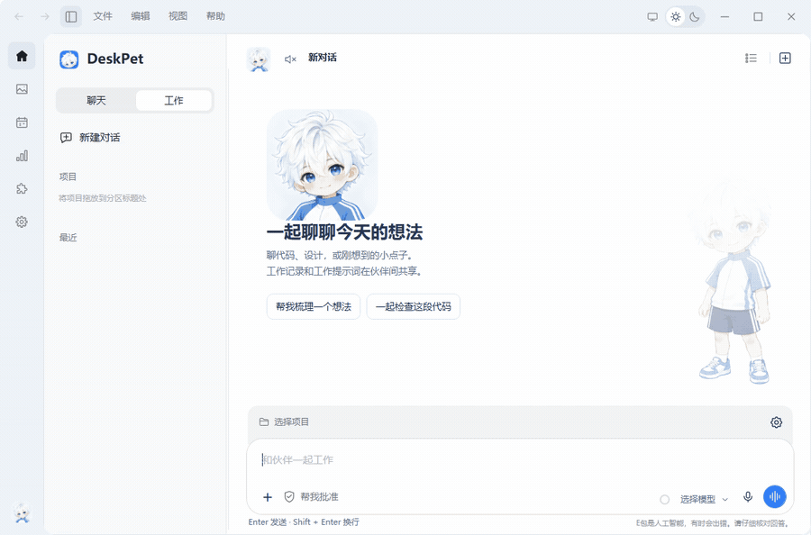
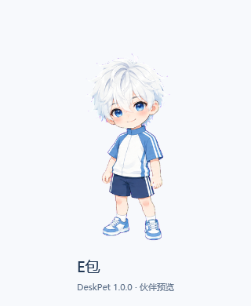
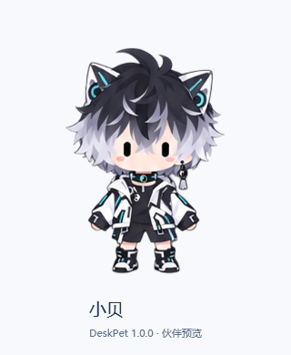
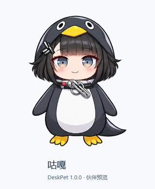

[简体中文](README.md) · [English](README.en.md)

# DeskPet · 桌面伙伴

A desktop companion for everyday interactions, conversations, and project work. Version 1.0.8 brings reversible, continuous transitions, a livelier Companion Home, and better workspace goals and GitHub pushing.

[Download the stable release](https://github.com/Eason4869/deskpet/releases/latest) · [Quick start](#quick-start) · [Changelog](CHANGELOG.en.md) · [Report an issue](https://github.com/Eason4869/deskpet/issues)

## Highlights

| Feature | Where to use it |
| --- | --- |
| **Companion transitions** | Pick a companion from the main chat window's avatar menu. Once ready, an avatar ripple or a zipper reveal opens the new chat view. The partner settings offer Off, Avatar ripple, Zipper reveal, and Random. |
| **Light and dark themes** | Select the sun or moon for a direct switch, or the monitor to follow the system. Appearance offers Flow, Ripple, Refraction, Zipper, and Random. Switch back mid-animation to reverse it, or keep working while it plays. Theme sounds have their own switch and volume. |
| **Companion Home** | Cards rise into view, the relationship ring draws clockwise, and journey entries appear from oldest to newest. Reduced motion shows the final state immediately. |
| **Scheduled tasks** | Start from one of six illustrated templates, describe what to do and when in chat, or fill out a form. |
| **Windows workspace** | Reopen a side chat from its conversation's work summary. Connect to GitHub through CLI device authorization or a PAT to create repos, commit, push, and open pull requests. |

## Download and install

| Platform | Requirements | Installation |
| --- | --- | --- |
| Windows | Windows 10 / 11 x64 and .NET Framework 4.8 or later | Get the installer or portable ZIP from the [release page](https://github.com/Eason4869/deskpet/releases/latest). Extract the entire portable ZIP before launching **桌面伙伴.exe**. |
| macOS preview | macOS 14 or later, Apple Silicon or Intel | Choose the DMG or ZIP for your processor. Preview bundles use ad-hoc signatures and have no Developer ID signature or notarization. |

The release includes source, companion packs, an authoring template, and SHA256 checksums. [Installation, updates, and backups](docs/installation.md)

## Quick start

1. **Meet your companion.** Drag it into position, click its head to pet it, or middle-click for the interaction wheel. These interactions run locally.
2. **Choose a companion.** E Bao's everyday animations ship with the app. Other official companions download on first selection and work offline once installed and verified. Seasonal outfits appear in the wardrobe.
3. **Configure a model and start chatting.** Open the setup guide or text-model settings. Enter your provider URL, protocol, API key, and model. Save and explicitly test the connection. Double-click your companion for quick chat or open the main window from its context menu.
4. **Work with project files on Windows.** Switch to Work, bind a project folder, choose a model with tool calling, and review permissions. Plan mode lets you review the work before execution.

Text models use OpenAI Chat Completions or Anthropic-compatible protocols. Requests go to the service you configure, which sets any usage charges. Dictation, spoken replies, image generation, web search, and Gemini Live have separate settings. [Setup guide](docs/configuration-guide.md) · [Models and voice](docs/dialogue-setup.md)

## Companions

| E Bao | Dafeiyu | Marfu | Xiaobei | Guga |
| :---: | :---: | :---: | :---: | :---: |
|  |  |  |  |  |

Each companion has its own personal chats, personality, voice preferences, and relationship history. Work projects and prompts are shared. Each official companion has a default look and ten seasonal outfits. You can import your own packs. [Daily interactions](docs/daily-use.md) · [Companion packs](docs/character-packs.md) · [Seasonal outfits](docs/holiday-outfits.md) · [Relationships and keepsakes](docs/companion-relationship/user-guide.md)

Windows settings let you adjust artwork opacity with a live preview in the lower-right corner. New configurations default to 50% for artwork opacity, theme transition volume, and operation sound volume.

Volume and companion-size sliders show their values as you drag and adapt to the active theme. Guga's desktop width and height are each 10% smaller at the selected companion size.

## Chat and project work

- **Chat and drafts.** Find, pin, archive, or move conversations between projects. The composer supports Markdown and image or file attachments. By default, **Enter** sends and **Shift + Enter** adds a line.
- **Work summary.** Windows shows Git changes, plans, goals, subagents, and sources. Closing a side-chat tab stops its pending requests. Reopen it from the owning conversation to recover the title, messages, and draft.
- **Workspace goals.** Pause, resume, edit, or delete a goal in the Windows Workspace pane. Its state is saved per conversation.
- **Workspace tools.** The Windows workspace supports file previews, a browser, a PowerShell terminal, and change inspection. Each conversation keeps its own tool layout in the current window. [Workflows, permissions, and sandboxing](docs/agent-workflows.md)
- **Local scheduled tasks.** Create tasks on Windows and macOS. Both drafts and saved tasks can return to the template gallery.

Quick Chat on Windows expands into Full Chat, which remembers its size and maximized state and has a minimum size of 520 × 560 logical pixels. Dark Quick Chat has a clearer, continuous border.

### GitHub access for the work agent

On Windows, open **Plugins → GitHub → Manage**. DeskPet can use an existing GitHub CLI login or open GitHub device authorization. After approval, select **Connect with GitHub CLI**. A fine-grained PAT is also supported.

With workspace approval, the agent can create repositories, link a remote, commit selected files, push the current branch with `git_push`, and open a pull request. Repositories start private. A selected-file commit preserves other staged changes.

## Other features

| Feature | Guide |
| --- | --- |
| Image generation, gallery, favorites, filters, and trash | [Image generation](docs/image-generation.md) |
| Dictation, spoken replies, and Gemini Live | [Voice setup](docs/dialogue-setup.md) |
| Proactive greetings, desktop observation, and image descriptions | [Desktop awareness](docs/proactive-desktop.md) |
| Text chats on QQ, WeChat, Feishu, DingTalk, and WeCom | [Messaging channels](docs/im-channels.md) |
| Skills, MCP, web search, and usage statistics | [Agent workflows](docs/agent-workflows.md) |

DeskPet supports 13 interface languages. Change the language from the avatar menu or from Appearance in General settings.

## Build and develop

From the repository root, run these commands in Windows PowerShell. The build uses .NET Framework 4.8, System.Speech, Python, and Pillow.

~~~powershell
python -m pip install Pillow
.\Build.ps1 -Target App -OutputDirectory "$PWD\work\local-app"
~~~

Launch **桌面伙伴.exe** from **work/local-app**. The Windows installer uses Inno Setup. Avalonia and the shared core use the .NET 10 SDK pinned in **desktop/global.json**. [macOS bridge](desktop/DeskPet.Platform.Mac/README.md) · [Apple Silicon and Intel packaging](installer/macos/README.md)

[Development branch](https://github.com/Eason4869/deskpet/tree/dev) · [Development log](docs/development-log.md) · [Release file naming and verification](docs/release-naming.md)

## Author and licenses

Created by **彧晟Eason**. Artwork, platform marks, fonts, and dependencies have their own terms. [Sources](docs/sources.md) · [Third-party notices](docs/third-party-notices.md). Contact the author for permission to redistribute the whole project or use it commercially.
