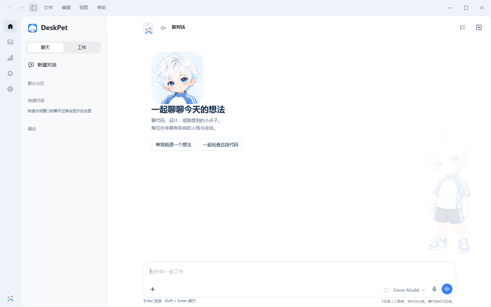
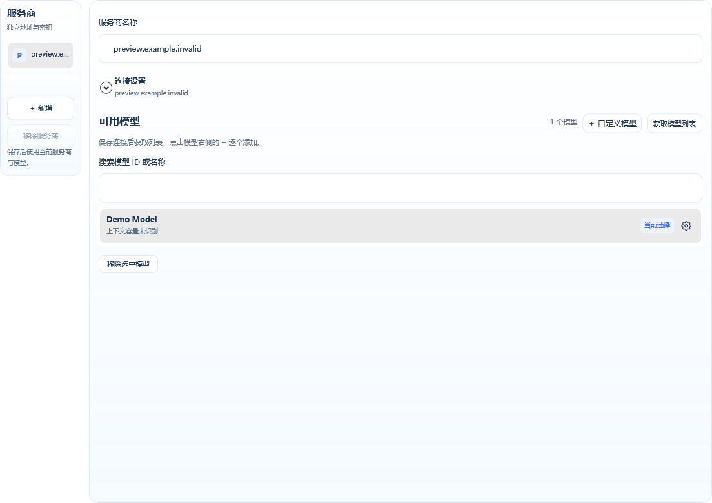
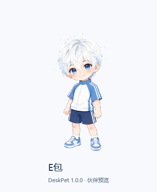
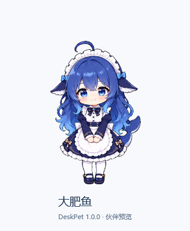
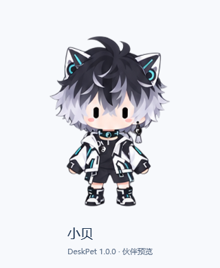
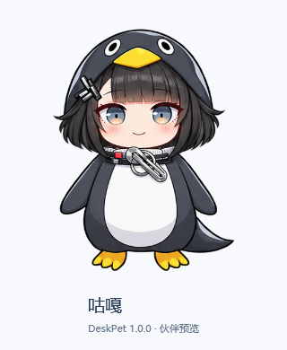
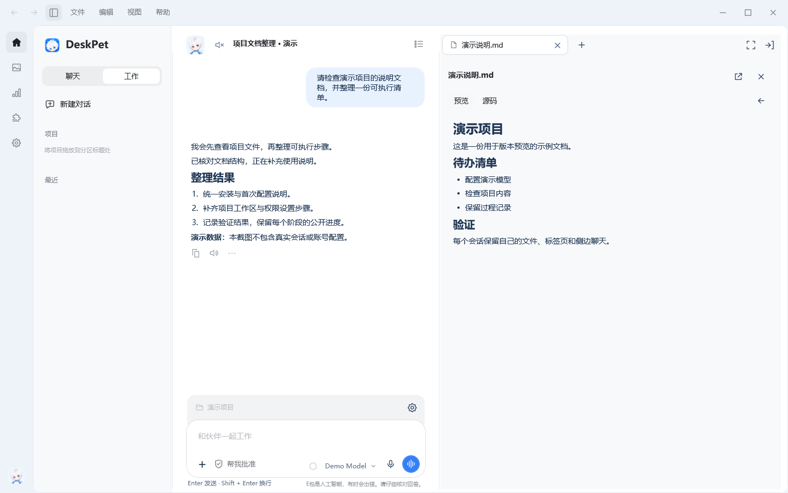
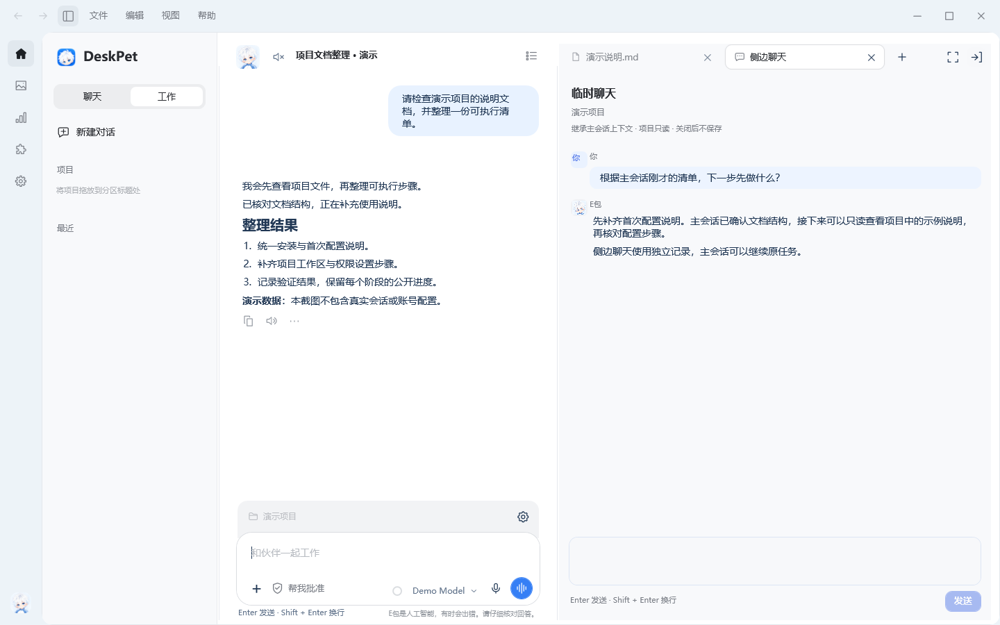
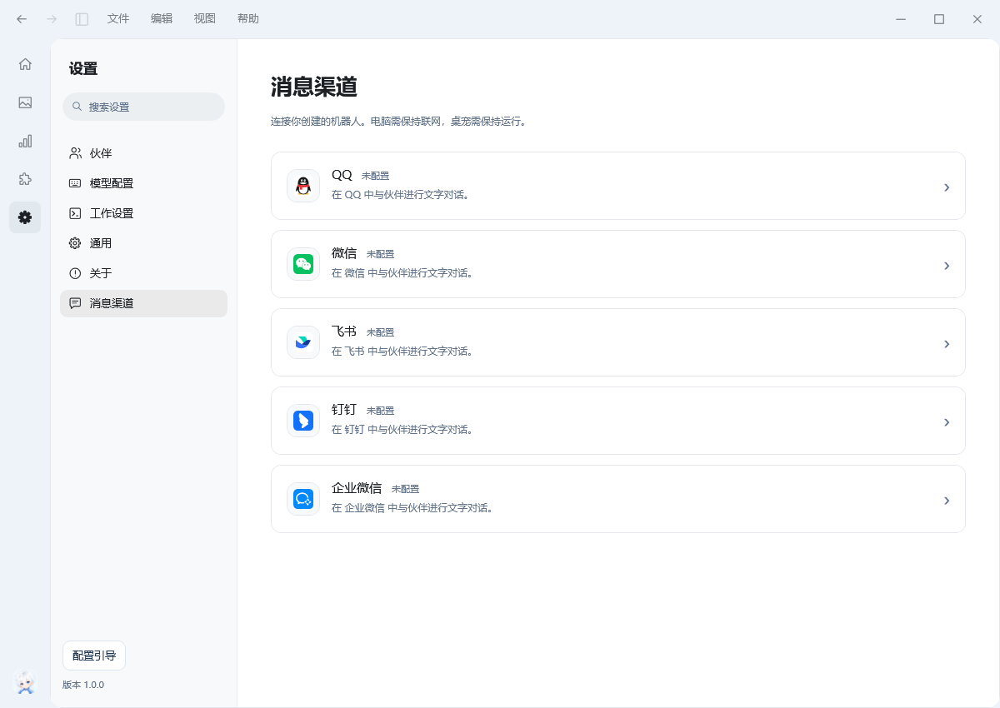

[简体中文](README.md) | [English](README.en.md)

# DeskPet · 桌面伙伴

A desktop companion for interactions, conversation and project work.

**1.0.1 · Current production release:** [Download](https://github.com/Eason4869/deskpet/releases/tag/v1.0.1) · [Quick start](#quick-start) · [Changelog](CHANGELOG.en.md) · [Issues](https://github.com/Eason4869/deskpet/issues)

Current source version: **1.0.2 (unreleased)**. It includes web search, settings and link-opening improvements, consistent dialogs and tray reminders, gentle notification sounds and automatic proactive-greeting speech. See the [changelog](CHANGELOG.en.md). No 1.0.2 tag or release has been created; production downloads below still point to `1.0.1`.



> Screenshots come from an isolated preview of the `1.0.0` Windows release; the development preview may have UI changes. Conversations, projects and model names are demonstration data, without personal chats or account configuration. macOS remains a platform preview with a separate interface.

## Download

| Platform | Requirements | Download and scope |
| --- | --- | --- |
| **Windows** | Windows 10 / 11 x64, .NET Framework 4.8 or later | Open the [1.0.1 release](https://github.com/Eason4869/deskpet/releases/tag/v1.0.1) and choose the `DeskPet-Windows-Setup-1.0.1.exe` installer or `DeskPet-Windows-1.0.1.zip` portable package. This page primarily describes Windows. |
| **macOS preview** | macOS 14+, Apple Silicon or Intel | Choose the matching `preview` DMG / ZIP on the same release page. The Mac app shares part of the core and has its own interface. Windows file-Agent, tool-tab and terminal support does not imply Mac support. |

The release also provides source, companion packs, an authoring template and SHA256 checksums; consult its actual asset list. Windows packages are currently not code-signed. Mac previews are ad-hoc signed, without Developer ID signing or notarization. Download from [Eason4869/deskpet](https://github.com/Eason4869/deskpet).

The Windows installer installs for the current user, normally without administrator privileges, under `%LOCALAPPDATA%\Programs\EbaoDeskPet`. For a portable installation, fully extract the ZIP to a writable folder and launch **桌面伙伴.exe**. Do not run it inside the archive.

## Quick start

1. **Try an interaction.** Drag the companion, click its head for a pat, or middle-click to open the action palette. These interactions require no model configuration.
2. **Choose a companion.** A fresh installation starts with Ebao. Other official companions download their complete packs when first selected. Settings also offers **Download/update all**.
3. **Configure a text model.** Open **Settings → Setup guide**, or **Model configuration → Text models**. Add a provider, enter its URL, protocol and API key, save and fetch models, then add the models you need individually. You can also enter a complete model ID manually.
4. **Test, then chat.** Explicitly run a connection test. Double-click the companion for quick chat; right-click it or double-click the tray icon to open the full window. Defaults: **Enter to send, Shift + Enter for a new line**.
5. **Switch to Work for files.** Add a project and bind its folder, select a model with native tool calling, review permissions and send a task. Use plan mode to inspect a project first, or stay in ordinary chat.

The setup guide supports skipping steps and continuing later. Configure dictation, speech, images and Live separately as needed. Saving settings alone does not test a service. See the [setup guide](docs/configuration-guide.md) and [model and voice configuration](docs/dialogue-setup.md).

### Models, accounts and costs

DeskPet uses your own model services. It includes no model account, API key or calling credits. Text models use OpenAI Chat Completions or Anthropic compatible protocols. A listed model is not necessarily capable of image understanding or tool calling; configure its actual capabilities.

Chats, file-reading results, images and audio may be sent to the services you choose. Multi-turn Agent runs, automatic review, predictions, titles, history compaction and AI greetings may make additional requests. Your provider determines charges. Dictation, cloud speech, image generation and Gemini Live have independent configurations; Windows system speech needs no cloud TTS service. Predictions can be disabled in editor settings.

For a compatible local or LAN service, enter its actual URL, port and API prefix. Public services use HTTPS. Each service has an independent HTTP proxy setting; enable the default `http://127.0.0.1:7890` only when that proxy is running on your computer.



## Five companions

| Ebao · E包 | Dafeiyu · 大肥鱼 | Marfu · 马尔芙 | Xiaobei · 小贝 | Guga · 咕嘎 |
| :---: | :---: | :---: | :---: | :---: |
|  |  |  |  |  |
| White hair, blue eyes and a sharp tongue | A gentle, playful whale girl | A magical girl with blonde hair and green eyes | A quick-witted, gentle technology-themed boy | A curious, food-loving girl in a penguin outfit |

Each companion has separate ordinary-chat history, personality, voice preferences and relationship records. Work projects and the work prompt are shared. Ebao's bundled default artwork supports offline startup. Installed, valid companion packs work offline; first downloads need a network connection.

Drag, pet, feed, nap, use signature actions, wander and follow the pointer. Available actions depend on the current pack. Interactions remain available while working or waiting for a reply. The five official companions each have a default appearance and ten holiday outfits. Choose unlocked outfits in the Wardrobe; the relationship home and album record earned growth and holiday keepsakes. Complete custom ZIP packs can also be imported.

See [daily interactions](docs/daily-use.md), [character packs](docs/character-packs.md), [holiday outfits](docs/holiday-outfits.md) and [relationships and keepsakes](docs/companion-relationship/user-guide.en.md).

## Chat and project work



### Conversations, drafts and public progress

Quick chat is for a short exchange. Reopening starts a new topic; previous records remain in the current companion's Quick Chat group. Ordinary chats have their own context. Work mode binds a project, reads/searches/creates/edits files, and shows actual tool records and net file changes.

Organize conversations into sections, rename, pin, archive, drag to reorder or move work conversations between projects. Switching preserves each conversation's draft and reading position; new-conversation drafts support encrypted recovery. Use Markdown or plain text, and add image, file and folder references through **+**, paste or drag and drop. A folder attachment does not expand file permissions.

The Agent's public progress explanations remain in the reply body. Later tool calls do not move already displayed text into the thinking section. Tool records, changes and delivered files have their own entries. Queue follow-up instructions, or **Steer** at the next adjustable boundary. Completed changes are not automatically undone.

### Web search and source citations

Open **Settings → Tools and connections → Web search**, enable it, choose native model search, an external search provider or a custom endpoint with a compatible API format, then save. Native search requires support from the selected model service. External providers use separate addresses and credentials and may incur additional charges. Ordinary chat, quick chat and work mode can use web search. Enable **Show source citations** to include retrieved sources at the bottom of replies.

On Windows, left-clicking an HTTP/HTTPS link in a conversation, including a source citation below a reply, opens an embedded browser tool tab by default. Quick chat opens the tools in the full chat window; temporary side chat uses its owning window's tools. Narrow windows switch to the full-tab layout. Right-click a link and choose **Open in default browser** to use the external browser, or copy its address. Citation clicks preserve the reading position, keyboard selection to the document end still scrolls correctly, and Markdown images in replies retain image previews.

### Tools belonging to the current conversation

Open file previews, a browser, PowerShell terminals, changes and temporary side chats on the right. Tabs, content, selection, hidden state and layout are retained separately for each main conversation and restored when switching back **within the current window**. Closing a tab releases its instance; closing the window releases its tools. This does not promise persistence across app restarts.

File cards preview HTML, Markdown and source, and support opening, revealing, copying paths and saving copies. **Open with** lists Windows applications applicable to the file and offers the system application picker. External HTML resources are off by default. The embedded browser currently has no download support. Manual terminals retain their opening project and sandbox settings; closing a terminal tab ends its process tree.

| Shortcut | Action |
| --- | --- |
| **Ctrl + Shift + S** | Show/hide the conversation sidebar |
| **Ctrl + Shift + B** | New tool tab |
| **Ctrl + Shift + F** | Switch split/full-tab layouts |
| **Ctrl + backtick** | Open a manual terminal |
| **Ctrl + Alt + S** | Open temporary side chat |

### Ask a side question with the main conversation's context



Open a temporary side chat from the main composer's **`/` menu**, window menu or tool tabs. Each request reads the **owning main conversation's public history**, alongside the side chat's own temporary messages. Switching main conversations does not rebind it to another context.

When a valid project is bound and the model supports tools, side chat can inspect that project through read-only tools. It cannot edit files or execute commands. Its model and project settings are captured when opened. Its independent history is not saved to conversation storage; closing its tab cancels its own request. Use it to clarify a term, check an implementation or discuss another approach.

## Work permissions and local data

Windows includes a file Agent; no separate Agent CLI is required. Plan mode rejects writes at the tool layer. File edits keep backups by default, and restoration checks later changes.

| Permission | Behavior |
| --- | --- |
| **Ask for approval** | Routine project-file operations can proceed; exceptions such as access outside the workspace or networking require confirmation. Agent terminal commands require individual human approval. |
| **Approve for me** | Default for new configurations. A separate reviewer model handles eligible operations; uncertainty or review failure falls back to human confirmation. Agent terminal commands still require individual human approval. |
| **Full access** | After confirmation, expands access to the current account's accessible files and disables the workspace sandbox. It does not grant administrator privileges. |

The Agent terminal is disabled by default. With the workspace sandbox enabled, Windows AppContainer restricts terminal/child-process directories and blocks networking by default. Isolation failure stops execution. Sandboxing does not waive terminal approval. Manual and Agent terminals are managed separately. MCP is outside the terminal sandbox; MCP and GitHub writes retain separate confirmation.

Windows settings and personal data live in the application's **data** folder, normally `%LOCALAPPDATA%\Programs\EbaoDeskPet\data`. Keys are protected for the current Windows user; another machine or user may require re-entry. macOS uses `~/Library/Application Support/DeskPet` and cannot directly decrypt Windows data. Exit the app and back up the complete data directory before upgrading or migrating.

## Images, voice and extensions

| Feature | Use and limits |
| --- | --- |
| **Image generation, gallery and tasks** | Configure an image model separately, generate with references, track progress, cancel or retry explicitly. The gallery supports favorites, filtering, batch export and a recycle bin. Agent replies can display generated images. |
| **Dictation, speech and Live** | Dictation fills a draft; replies can be read aloud. Gemini Live uses a separate real-time voice connection. Microphone access starts after an explicit action. |
| **Greetings and desktop observation** | Use local preset or AI greetings. Observation is off by default and requires confirmation of capture scope and receiving services. Windows can capture the active application or full desktop; images may contain sensitive content and automatic redaction is not guaranteed. |
| **Skills and MCP** | Discover skills in public GitHub repositories, or import ZIP/local folders. Explicitly connect stdio / HTTP MCP servers; HTTP supports a JSON subset, not SSE. Saving a connection is not a successful startup or test. |
| **Usage** | Text request counts, tokens, heat maps and conversation rankings distinguish actual, estimated, unknown and zero. ASR, TTS and Live are excluded. This is not a provider bill or subscription balance. |
| **Appearance and languages** | Light, dark or system themes; thirteen interface languages with live switching. Generated translations have resource checks, but not native-speaker review. |

Guides: [image generation](docs/image-generation.md) · [desktop observation and image descriptions](docs/proactive-desktop.en.md) · [voice configuration](docs/dialogue-setup.md) · [work and tools](docs/agent-workflows.md).

## Messaging channels



Configure QQ, WeChat, Feishu, DingTalk and WeCom from the dedicated messaging settings entry. Use your own platform account or bot credentials. The app connects outbound from your computer, with no public IP, port forwarding or additional bot runtime required. Your computer must remain on, online and running DeskPet.

Current channels support text only. Remote contexts are separate from desktop chats and expose no file Agent, terminal or desktop control. Sender/group ID restrictions are optional; groups require an actual bot mention, and group availability depends on the platform/account. QR generation and UI checks do not establish real-account authorization or successful message round trips. Test with your own account first. Keep credentials and login QR codes private.

See [messaging channels](docs/im-channels.md) for setup, platform preparation and validation limits.

## Updates, documentation and development

Windows offers stable/preview channels under **About and updates**. Updates verify assets, then wait for tasks, drafts and data to be safely saved before installation. They never downgrade. Older installed versions that cannot recognize current asset names can use the [latest release](https://github.com/Eason4869/deskpet/releases/latest) for a manual installation. Retain and first back up the existing `data` folder.

| Guide | Contents |
| --- | --- |
| [Installation, updates and backup](docs/installation.md) | Directories, startup, updating and removal |
| [Setup guide](docs/configuration-guide.md) | Companions, models, voice and work settings |
| [Work and tools](docs/agent-workflows.md) | Permissions, tabs, file delivery and task recovery |
| [Character packs](docs/character-packs.md) · [format](docs/skin-format.md) | Importing, updating and creating companions |
| [1.0.0 changelog](CHANGELOG.en.md) · [development log](docs/development-log.en.md) | Production release overview and complete history |

Some detailed guides retain titles and screenshots from their original versions. For current side-chat, tool-state and UI behavior, use this page and the 1.0.0 changelog. Some detailed guides are in Chinese.

Source layout: `src/` contains Windows WPF and shared business logic; `desktop/` contains .NET 10 / Avalonia and Mac platform services; `tests/` contains Windows checks; `.github/workflows/` defines build and publication checks. Ongoing development is on [dev](https://github.com/Eason4869/deskpet/tree/dev).

From PowerShell at the repository root, build Windows with an explicit output directory inside the repository:

```powershell
.\Build.ps1 -Target App -OutputDirectory "$PWD\work\local-app"
```

Windows uses the system .NET Framework compiler and System.Speech. Docker is not required. Shared-core/Avalonia development uses the .NET 10 SDK pinned in `desktop/global.json`; the Mac native bridge must be built on a Mac. See [platform development](desktop/DeskPet.Platform.Mac/README.md). Packaging additionally uses Python / Pillow, and installer compilation uses Inno Setup; consult repository scripts and CI for the full toolchain.

## Source, artwork and licenses

Author: **彧晟Eason**. Artwork, platform identifiers, fonts and dependencies have their own sources and licenses. See [artwork and platform sources](docs/sources.md) and [third-party notices](docs/third-party-notices.md). Provider identifiers do not imply a partnership or endorsement.

The repository currently has no standalone LICENSE covering the entire project. Publicly viewable source does not make third-party component licenses apply to the whole project. Confirm authorization with the author before redistribution or commercial use.
