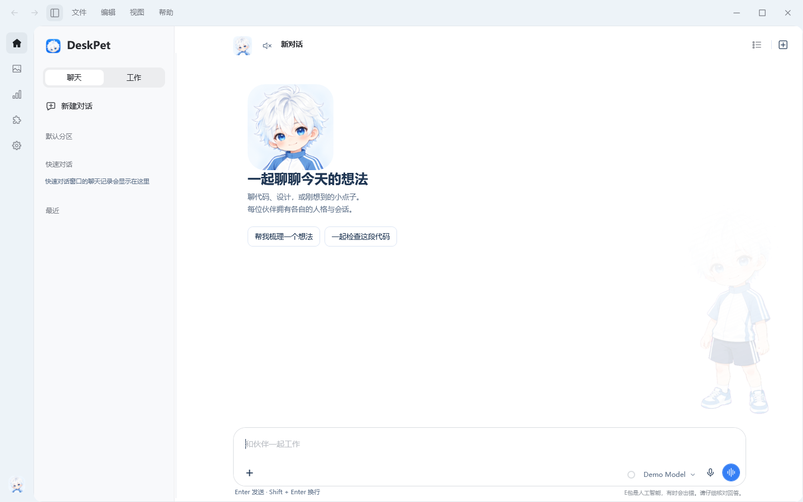
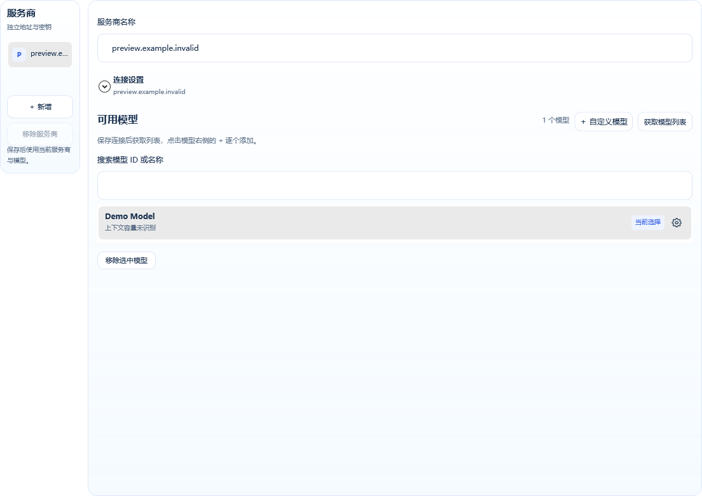
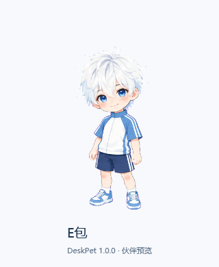
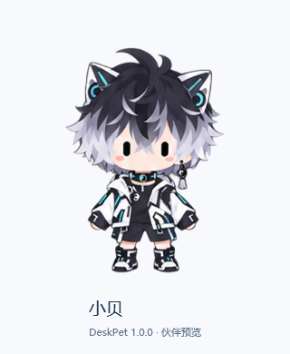
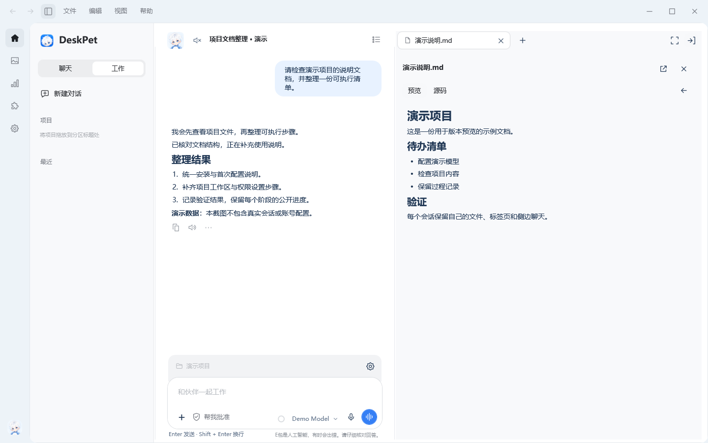
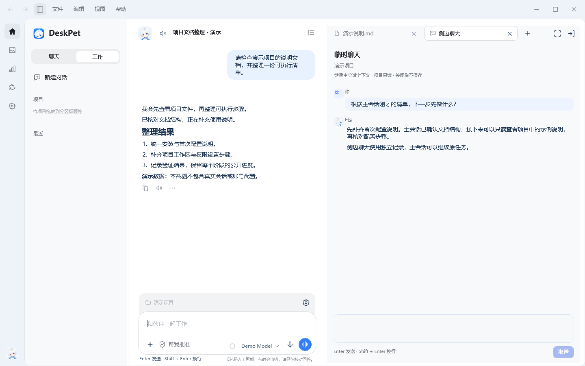
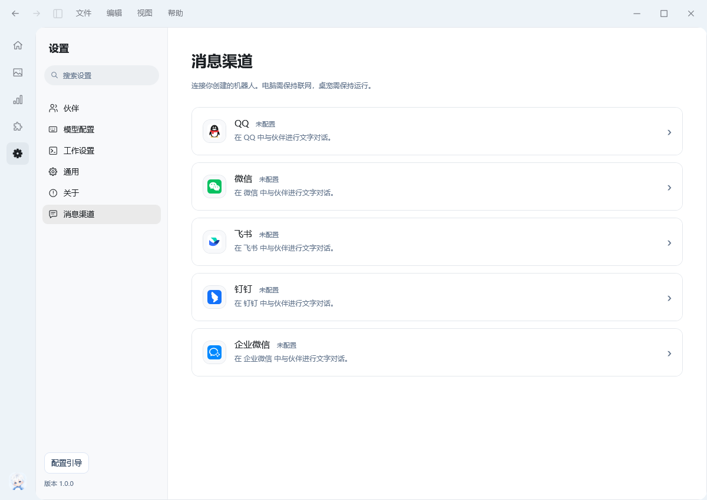

[简体中文](README.md) | [English](README.en.md)

# 桌面伙伴 · DeskPet

一个可以互动、聊天，也能陪你处理项目文件的桌面伙伴。

**1.0.3 · 当前正式版**：[下载安装](https://github.com/Eason4869/deskpet/releases/tag/v1.0.3) · [快速开始](#快速开始) · [更新日志](CHANGELOG.md) · [问题反馈](https://github.com/Eason4869/deskpet/issues)

1.0.3 为密钥输入框加入显示／隐藏按钮，改进 Windows 生图结果卡片，并修复同密钥切换遮挡及 Windows 无障碍名称问题。详见[更新日志](CHANGELOG.md)。



> 本页界面图来自 `1.0.0` Windows 正式版的隔离预览；开发预览的界面可能有所调整。会话、项目和模型名称均为演示内容，不含个人聊天或真实账号配置。macOS 仍为独立界面的平台预览。

## 下载安装

| 平台 | 系统要求 | 下载与范围 |
| --- | --- | --- |
| **Windows** | Windows 10 / 11 x64，.NET Framework 4.8 或更新版本 | [1.0.3 发布页](https://github.com/Eason4869/deskpet/releases/tag/v1.0.3)，选择 `DeskPet-Windows-Setup-1.0.3.exe` 安装版或 `DeskPet-Windows-1.0.3.zip` 便携版。下文主要介绍 Windows。 |
| **macOS 预览** | macOS 14+，Apple Silicon 或 Intel | 在同一发布页选择对应架构的 `preview` DMG / ZIP。共享部分核心，使用独立界面；Windows 的文件 Agent、工具标签与终端不代表 Mac 已支持。 |

发布页同时提供源码、角色包、创作模板及 SHA256 校验文件；实际附件以发布页为准。Windows 安装包当前未做应用代码签名；Mac 预览为 ad-hoc 签名，未做 Developer ID 签名或公证。下载请认准 [Eason4869/deskpet](https://github.com/Eason4869/deskpet)。

Windows 安装版按当前用户安装，默认目录为 `%LOCALAPPDATA%\Programs\EbaoDeskPet`，通常不需要管理员权限。便携版需完整解压到可写目录，再运行 **桌面伙伴.exe**，不要在压缩包内启动。

## 快速开始

1. **先试互动。** 拖动伙伴换位置，单击头部摸摸头，中键打开动作轮盘。桌宠互动不需要配置模型。
2. **选择伙伴。** 首次启动默认 E包。其他官方伙伴首次选择时下载完整角色包；在设置中也可选择“全量下载／更新”。
3. **配置文字模型。** 打开 **设置 → 配置引导**，或进入 **模型配置 → 文字模型**，新增服务商，填写地址、协议和 API Key，保存并获取模型，再逐个添加需要的模型。也可手动填写完整模型 ID。
4. **测试后聊天。** 主动点击连接测试，确认可用。双击伙伴打开快速对话，右键伙伴或双击托盘图标打开完整窗口。默认 **Enter 发送，Shift + Enter 换行**。
5. **需要处理文件时切到“工作”。** 添加项目并绑定目录，选择支持原生工具调用的模型，核对权限后发送任务。先用计划模式阅读项目，也可以只使用普通聊天。

配置引导可以跳过、稍后继续；听写、朗读、生图和 Live 按需单独配置。仅保存设置不会自动完成服务测试。详见[配置引导](docs/configuration-guide.md)和[模型与语音配置](docs/dialogue-setup.md)。

密钥输入框默认隐藏；点击右侧眼睛临时显示，再次点击隐藏。显隐切换不会修改已填内容或自动保存配置，仍需使用所在页面的保存操作。

### 模型、账号与费用

DeskPet 使用你自己的模型服务，不附赠模型账号、API Key 或调用额度。文字模型支持 OpenAI Chat Completions 与 Anthropic 兼容协议；能列出模型不代表它具备图片理解或工具调用能力，请按服务商实际能力配置。

聊天、文件读取结果、图片与音频会发送给你选择的服务。多轮 Agent、自动审核、预测消息、标题生成、历史压缩和 AI 问候可能产生额外请求；费用以服务商账单为准。听写、云端朗读、生图与 Gemini Live 各自使用独立配置；Windows 系统朗读无需云端 TTS。预测消息可在编辑器设置中关闭。

如使用本机或局域网兼容服务，填写它实际提供的地址、端口与接口前缀；公网服务使用 HTTPS。每项服务独立设置 HTTP 代理，默认地址 `http://127.0.0.1:7890` 仅在本机确实运行该代理时启用。



## 五位伙伴

| E包 | 大肥鱼 | 马尔芙 | 小贝 | 咕嘎 |
| :---: | :---: | :---: | :---: | :---: |
|  |  |  |  |  |
| 白发蓝眸，傲娇毒舌 | 温和俏皮的鲸鱼娘 | 金发绿眼的魔法少女 | 机灵温柔的科技少年 | 好奇贪吃的企鹅服女孩 |

每位伙伴保留自己的普通聊天、人格、音色偏好和关系记录；工作项目与工作提示词共享。默认 E包素材可离线启动，已安装且校验有效的角色包可离线使用，其他包首次下载需要联网。

拖动、抚摸、投喂、小憩、招牌动作、散步与视线跟随都可直接使用，动作以当前角色包为准。工作或等待回复时仍能互动。五位官方伙伴各有默认与十套节日外观；已解锁衣装可在衣柜选择，关系主页与纪念册记录实际获得的成长和节日卡片。也支持导入自制完整 ZIP 角色包。

详见[日常互动](docs/daily-use.md)、[角色包](docs/character-packs.md)、[节日服饰](docs/holiday-outfits.md)和[关系与纪念册](docs/companion-relationship/user-guide.md)。

## 聊天与项目工作



### 对话、草稿和公开过程

快速对话适合聊两句；再次打开会开始新话题，旧记录留在当前伙伴的“快速对话”分组。普通聊天管理独立上下文；工作模式绑定项目，可读取、搜索、创建和修改文件，并查看实际工具记录与文件净变更。

会话支持分区、重命名、置顶、归档、拖动排序与跨项目移动。切换会话保留相应草稿和阅读位置，新对话草稿支持加密恢复。输入支持 Markdown、纯文本切换，以及通过 **+**、粘贴或拖放添加图片、文件和目录引用。目录附件不会自动扩大文件权限。

Agent 公开说明的处理步骤持续保留在回复正文中，后续工具调用不会把已显示的文字挪入思考区。工具记录、变更和最终交付文件各有入口。运行中可排队追加要求，或使用“引导”在下一处可调整的边界补充要求；已经完成的修改不会自动撤销。

### 网页搜索与引用来源

打开 **设置 → 工具与连接 → 网页搜索**，启用后选择模型原生搜索、独立搜索服务或兼容格式的自定义接口，再保存配置。原生搜索需要模型服务支持对应接口；独立搜索服务使用各自的地址与密钥，可能产生额外费用。普通对话、快速对话和工作模式均可使用网页搜索；启用 **显示来源引用** 后，搜索得到的来源可附在回答底部。

在 Windows 中，左键点击对话里的 HTTP／HTTPS 链接，包括回答底部的来源引用，默认在内置浏览器工具标签打开。快速对话会转入完整聊天窗口的工具区，临时侧聊使用所属窗口的工具区；窄窗口切到完整标签视图。右键链接仍可选择 **在默认浏览器打开** 或复制地址。点击引用时保持阅读位置，键盘扩选到文末仍会正常滚动；回答中的 Markdown 图片继续使用图片预览。

### 当前会话自己的工具区

右侧可打开文件预览、浏览器、PowerShell 终端、变更详情和临时侧边聊天。工具标签、内容、选中项、隐藏状态与布局按主会话分别保留，**在当前窗口内**切回时恢复；关闭工具标签释放对应实例，关闭整个窗口释放工具，不承诺跨进程恢复。

文件卡片支持 HTML、Markdown 与源码预览，可打开文件、定位、复制路径或另存。**打开方式**列出适用于该文件的 Windows 应用，并提供系统应用选择器。HTML 外部资源默认关闭；内置浏览器目前不提供下载。手动终端保留启动时的项目和沙箱设置，关闭标签结束对应进程树。

| 快捷键 | 操作 |
| --- | --- |
| **Ctrl + Shift + S** | 显示／隐藏会话侧栏 |
| **Ctrl + Shift + B** | 新建工具标签 |
| **Ctrl + Shift + F** | 切换分屏／完整标签视图 |
| **Ctrl + 反引号** | 打开手动终端 |
| **Ctrl + Alt + S** | 打开临时侧边聊天 |

### 带着主会话背景，临时问一句



从主输入框的 **`/` 菜单**、窗口菜单或工具标签打开临时侧边聊天。它每次发送时读取**所属主会话的公开历史**，同时保留自己的临时问答；切到其他主会话不会改绑上下文。

绑定有效项目且模型支持工具时，可只读查看该项目，不能修改文件或执行命令。侧聊沿用打开时的模型与项目设置，独立历史不写入会话记录；关闭标签取消它自己的请求。适合追问一个术语、核对一段实现，或临时讨论另一种做法。

## 工作权限与本机数据

Windows 内置文件 Agent，无需另装 Agent 命令行工具。计划模式在工具层禁止写入，文件修改默认保留备份；恢复前核对后续变更。

| 权限 | 行为 |
| --- | --- |
| **请求批准** | 常规项目文件操作可直接执行；越界、联网等例外交给你确认。Agent 终端命令逐条人工批准。 |
| **帮我批准** | 新配置默认值。独立审核模型处理符合条件的操作，不确定或审核失败转人工；Agent 终端命令仍逐条人工批准。 |
| **完全访问权限** | 确认后扩大到当前账户可访问的范围，并关闭工作区沙箱；不会获得管理员权限。 |

Agent 终端默认关闭。启用工作区沙箱时，Windows 使用 AppContainer 限制终端及其子进程的目录访问，默认阻止联网；隔离失败会停止执行。沙箱不免除上述终端审批。手动终端与 Agent 终端独立管理；MCP 不在终端沙箱内，MCP 与 GitHub 写入保留独立确认。

Windows 设置和个人数据保存在程序目录的 **data** 文件夹；默认安装位置为 `%LOCALAPPDATA%\Programs\EbaoDeskPet\data`。密钥按当前 Windows 用户保护，换机器或用户后可能需要重新填写。macOS 使用 `~/Library/Application Support/DeskPet`，不能直接解密 Windows 的密文数据。升级或迁移前先退出程序、备份完整数据目录。

## 图像、语音与扩展

| 功能 | 使用方式与边界 |
| --- | --- |
| **生图、图库与任务** | 独立配置图片模型，可带参考图生成，查看进度、取消或手动重试；图库支持收藏、筛选、多选导出及回收站。Agent 可在对话中返回生成图片。Windows 结果卡片提供预览、另存为、复制图片与打开所在文件夹，窄卡片的长按钮文案自动换行。 |
| **听写、朗读与 Live** | 听写将语音转成草稿，回复可自动朗读；Gemini Live 提供独立实时语音连接。麦克风在你主动操作后启用。 |
| **主动问候与识屏** | 可使用本地预设或 AI 问候；识屏默认关闭，需明确确认截图范围与接收服务。Windows 可选择活动应用或全屏，截图可能包含敏感信息，不保证自动打码。 |
| **技能与 MCP** | 技能支持公开 GitHub 仓库发现、ZIP 与本机目录导入。MCP 支持主动连接 stdio / HTTP；HTTP 为 JSON 子集，暂不支持 SSE。保存连接不等于已经启动或验证。 |
| **用量统计** | 查看文字请求次数、Token、热力图与会话排行，区分实值、估算、未知和零。暂不包含 ASR、TTS、Live，不等于服务商账单或套餐余额。 |
| **外观与语言** | 浅色、深色或跟随系统；13 种界面语言即时切换。自动生成译文经过资源检查，尚未经母语人工审校。 |

说明：[图像生成](docs/image-generation.md) · [桌面感知与图片转述](docs/proactive-desktop.md) · [声音配置](docs/dialogue-setup.md) · [工作与工具](docs/agent-workflows.md)。

## 消息渠道



在设置的独立消息渠道入口配置 QQ、微信、飞书、钉钉与企业微信。使用自己的平台账号或机器人凭据，由本机主动向平台连接，无需公网 IP、端口映射或额外机器人运行时；电脑需要保持开机、联网且 DeskPet 正在运行。

目前提供文字对话，远程上下文与桌面会话隔离，不开放文件 Agent、终端或桌面操作。发送者／群 ID 限制可选，群聊需真实 @ 机器人，实际群能力取决于平台与账号。二维码生成和界面检查不代表真实账号授权或消息往返已验收；请先用自己的账号测试。凭据与二维码不要公开分享。

配置、平台准备和验证边界见[消息渠道说明](docs/im-channels.md)。

## 升级、文档与开发

Windows 可在 **关于与更新** 选择正式或预览通道。更新校验附件后等待任务、草稿与数据安全保存再安装，不会降级。早期安装版若无法识别新包名，可从[最新发布页](https://github.com/Eason4869/deskpet/releases/latest)手动安装；保留并先备份原有 `data`。

| 文档 | 内容 |
| --- | --- |
| [安装、升级与备份](docs/installation.md) | 安装目录、自启、更新和卸载 |
| [配置引导](docs/configuration-guide.md) | 伙伴、模型、语音与工作配置 |
| [工作与工具](docs/agent-workflows.md) | 权限、工具标签、文件交付与任务恢复 |
| [角色包与自制外观](docs/character-packs.md) · [格式](docs/skin-format.md) | 导入、更新与制作伙伴 |
| [更新日志](CHANGELOG.md) · [开发日志](docs/development-log.md) | 当前预览、正式版概览及完整历史记录 |

详细指南中部分标题和截图保留其编写时的版本，最新侧聊、工具状态和界面行为以本页及更新日志为准。

源码结构：`src/` 为 Windows WPF 与共用业务，`desktop/` 为 .NET 10 / Avalonia 与 Mac 平台服务，`tests/` 为 Windows 验证，`.github/workflows/` 为构建与发布检查。开发分支为 [dev](https://github.com/Eason4869/deskpet/tree/dev)。

在仓库根目录的 PowerShell 中构建 Windows 程序，输出明确留在本仓库：

```powershell
.\Build.ps1 -Target App -OutputDirectory "$PWD\work\local-app"
```

Windows 构建使用系统 .NET Framework 编译器与 System.Speech；不需要 Docker。共享核心与 Avalonia 开发使用 `desktop/global.json` 指定的 .NET 10 SDK，Mac 原生桥接需在 Mac 构建，见[平台开发说明](desktop/DeskPet.Platform.Mac/README.md)。打包另需 Python / Pillow，安装器构建使用 Inno Setup；以仓库脚本与 CI 为准。

## 源码、素材与许可

作者：**彧晟Eason**。角色素材、平台标识、字体和依赖各有来源与许可，见[素材与平台说明](docs/sources.md)和[第三方声明](docs/third-party-notices.md)。服务商标识仅用于识别，不代表合作或背书。

当前仓库未提供覆盖整个项目的独立 LICENSE。源码可公开查看，但第三方组件的许可不等于本项目整体采用相同许可；再分发或商用前请先向作者确认授权范围。
