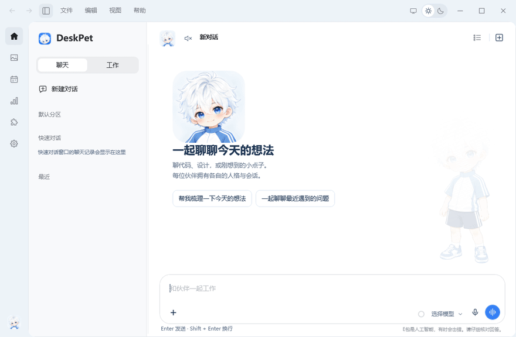
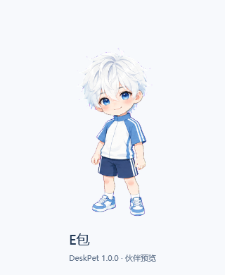
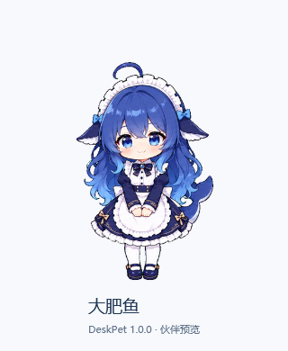
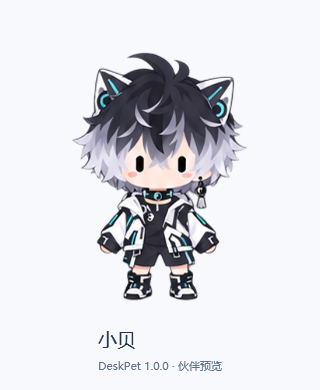
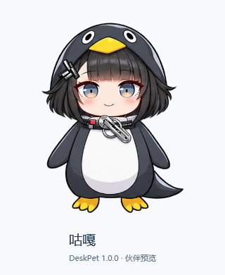

[简体中文](README.md) · [English](README.en.md)

# DeskPet · 桌面伙伴

让桌面上的伙伴陪你互动、聊天和处理项目。

[下载正式版](https://github.com/Eason4869/deskpet/releases/latest) · [快速开始](#快速开始) · [更新日志](CHANGELOG.md) · [反馈问题](https://github.com/Eason4869/deskpet/issues)

## 1.0.7 更新亮点

| 功能 | 怎么使用 |
| --- | --- |
| **角色切换动效** | 从主聊天窗口的头像菜单切换伙伴。新角色准备完成后，头像涟漪或拉链开场揭示新的聊天界面。在 **设置 → 伙伴 → 伙伴与人格** 可选关闭、头像涟漪、拉链开场或随机。 |
| **亮暗切换** | 点太阳或月亮直接切换，点显示器恢复跟随系统。外观设置提供流水、涟漪、折光、拉链和随机，主题音效可独立开启和调节。 |
| **定时任务** | 从六张彩色模板卡片开始，也可在聊天中描述时间和任务，或直接填写表单。 |
| **Windows 工作区** | 从工作摘要找回本会话的侧聊。工作 Agent 可通过 GitHub CLI 设备授权或 PAT 建仓、提交、推送和开 PR。 |

## 下载安装

| 平台 | 系统要求 | 安装方式 |
| --- | --- | --- |
| Windows | Windows 10 / 11 x64，.NET Framework 4.8 或更高 | 从[发布页](https://github.com/Eason4869/deskpet/releases/latest)选择 Windows 安装包或便携 ZIP。便携版需完整解压后启动 **桌面伙伴.exe**。 |
| macOS 预览 | macOS 14 或更高，Apple Silicon 或 Intel | 选择适用架构的 DMG 或 ZIP。预览包采用临时签名，未做 Developer ID 签名或公证。 |

发布页同时提供源码、角色包、皮肤创作模板和 SHA256 校验。[安装、升级、备份与卸载](docs/installation.md)

## 快速开始

1. **和伙伴互动**。拖动伙伴换位置，单击头部抚摸，按中键打开动作轮盘。互动可离线使用。
2. **选择伙伴**。E包的常规动作随应用提供。其余官方伙伴首次选择时下载，安装并校验后可离线使用。节日衣装可在衣柜查看。
3. **设置模型并开始聊天**。打开 **设置 → 配置引导** 或 **模型配置 → 文字模型**，填写自己的服务地址、协议、API Key 和模型，保存后点连接测试。双击伙伴打开快速对话，右键菜单可打开主窗口。
4. **在 Windows 处理项目**。切到 **工作**，绑定项目目录，选择支持工具调用的模型并核对权限。可先用计划模式梳理工作，再确认执行。

文字模型支持 OpenAI Chat Completions 和 Anthropic 兼容协议。请求发送给你配置的服务，费用以服务商账单为准。听写、朗读、生图、网页搜索和 Gemini Live 可单独配置。[配置引导](docs/configuration-guide.md) · [模型与语音](docs/dialogue-setup.md)

## 五位伙伴

| E包 | 大肥鱼 | 马尔芙 | 小贝 | 咕嘎 |
| :---: | :---: | :---: | :---: | :---: |
|  |  |  |  |  |

每位伙伴有独立的普通对话、人格、音色和关系记录。工作项目和工作提示词可跨伙伴使用。官方伙伴各有默认外观和十套节日衣装，也可导入自制角色包。[日常互动](docs/daily-use.md) · [角色包](docs/character-packs.md) · [节日衣装](docs/holiday-outfits.md) · [关系与纪念册](docs/companion-relationship/user-guide.md)

音量和伙伴大小的圆形滑块在拖动时显示当前数值，并适配亮暗主题。咕嘎的桌面显示宽高各缩小 10%，按已选的伙伴大小计算。

## 聊天与项目工作

- **聊天与草稿**。会话支持搜索、置顶、归档和跨项目移动。输入框支持 Markdown、图片和文件附件，默认 **Enter** 发送，**Shift + Enter** 换行。
- **工作摘要**。Windows 可查看 Git 变更、计划、目标、子智能体和来源。关闭侧聊标签会停止该侧聊的请求。从所属会话的工作摘要可恢复同一侧聊的标题、消息和草稿。
- **工具标签**。Windows 工作区支持文件预览、浏览器、PowerShell 终端和变更详情。当前窗口内的工具布局按会话保留。[工作流程、权限和沙箱](docs/agent-workflows.md)
- **本机定时任务**。Windows 和 macOS 可创建定时任务，草稿和已保存任务都可返回模板页。

### GitHub 与工作 Agent

在 Windows 的 **插件 → GitHub → 管理连接** 复用现有 CLI 登录，或从 DeskPet 打开 GitHub 设备授权。确认后选择 **使用 GitHub CLI 连接**，也可配置细粒度 PAT。

Agent 按工作区审批流程建仓、绑定远端、提交指定文件、推送当前分支并创建 PR。建仓默认私有，提交保留其余已暂存文件。首次使用工作模式时可在[工作流程指南](docs/agent-workflows.md)查看每种权限的具体行为。

## 更多功能

| 功能 | 使用说明 |
| --- | --- |
| 生图、图库、收藏、筛选和回收站 | [图像生成](docs/image-generation.md) |
| 听写、自动朗读和 Gemini Live | [语音配置](docs/dialogue-setup.md) |
| 主动问候、桌面识别与图片转述 | [桌面感知](docs/proactive-desktop.md) |
| QQ、微信、飞书、钉钉与企业微信文字对话 | [消息渠道](docs/im-channels.md) |
| 技能、MCP、网页搜索和用量统计 | [工作与工具](docs/agent-workflows.md) |

DeskPet 提供 13 种界面语言。可从头像菜单或 **设置 → 通用 → 外观与交互** 选择语言。

## 构建与开发

在 Windows 仓库根目录运行 PowerShell 命令。构建使用 .NET Framework 4.8、System.Speech、Python 和 Pillow。

~~~powershell
python -m pip install Pillow
.\Build.ps1 -Target App -OutputDirectory "$PWD\work\local-app"
~~~

从 **work/local-app** 启动 **桌面伙伴.exe**。Windows 安装器使用 Inno Setup。Avalonia 与共享核心使用 **desktop/global.json** 指定的 .NET 10 SDK。[Mac 原生桥接](desktop/DeskPet.Platform.Mac/README.md) · [Apple Silicon 和 Intel 打包](installer/macos/README.md)

[开发分支](https://github.com/Eason4869/deskpet/tree/dev) · [开发日志](docs/development-log.md) · [发布包命名与校验](docs/release-naming.md)

## 作者与许可

作者 **彧晟Eason**。素材、平台标识、字体和依赖各有许可。[素材来源](docs/sources.md) · [第三方声明](docs/third-party-notices.md)。再分发整个项目或用于商业用途前，请向作者确认授权。
