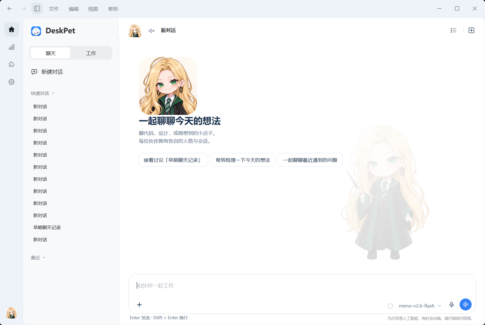

  
  <h1>桌面伙伴 · DeskPet</h1>
  
聊两句，做点事，让桌面多一个陪伴。

  
原画互动 · 独立人格 · 多项目工作 · 听写与朗读

  
<a href="https://github.com/Eason4869/deskpet/releases">下载安装</a> · <a href="#开始使用">开始使用</a> · <a href="docs/configuration-guide.md">配置引导</a> · <a href="CHANGELOG.md">更新日志</a>

**当前开发版本：0.9.0 · [dev 分支](https://github.com/Eason4869/deskpet/tree/dev)**。这一版把聊天、设置、插件和用量统计整合进同一个 Windows 主窗口，加入工具标签、本地技能管理和工作权限设置。

`dev` 是开发源码，不会自动成为客户端更新包。下载安装请以 [Releases](https://github.com/Eason4869/deskpet/releases) 中实际提供的附件为准。下文的新界面与操作以 Windows 版为准；macOS 是独立预览客户端，功能差异见 [平台与升级](#平台与升级)。

## 选一位伙伴

不接入 AI，也能拖着伙伴换个位置，看它望向鼠标、散步、打招呼，摸摸头、投喂，或让它安静地陪着你。

<table>
  <tr><th>E包</th><th>大肥鱼</th><th>马尔芙</th><th>小贝</th></tr>
  <tr>
    <td align="center"></td>
    <td align="center"></td>
    <td align="center"></td>
    <td align="center"></td>
  </tr>
  <tr><td align="center">傲娇毒舌的白发正太</td><td align="center">温和俏皮的鲸鱼娘</td><td align="center">聪明俏皮的魔法少女</td><td align="center">机灵温柔的科技少年</td></tr>
</table>

首次启动默认 E包。每位伙伴拥有各自的普通聊天记录、人格和音色偏好，也可以导入自己制作的外观。

| 操作 | 会发生什么 |
| --- | --- |
| 拖动伙伴 | 移动桌宠；锁定位置后保持原位 |
| 单击、抚摸 | 根据位置和伙伴触发互动 |
| 双击伙伴 | 打开快速对话 |
| 鼠标中键 | 打开动作轮盘，选择小憩、投喂或招牌动作 |
| 轮盘／右键选择向左跑、向右跑 | 实际移动一小段，到屏幕边缘停止；锁定位置时原地演示 |
| 右键伙伴 | 打开完整对话、设置和互动菜单 |
| 双击托盘图标 | 打开或恢复完整对话 |

伙伴思考、等待回复或工作时仍可拖动、点击和使用轮盘。开始拖动、暂停或换动作会停止手动跑动。

## 开始使用

1. 从 [Releases](https://github.com/Eason4869/deskpet/releases) 选择 Windows 安装版或便携 ZIP。便携版完整解压后运行 `桌面伙伴.exe`，不要在压缩包里直接启动。
2. 先选伙伴并试试互动。只想使用桌宠，可以暂时跳过全部 AI 配置。
3. 从 **设置 → 配置引导** 开始，按需要配置文字模型、听写、朗读或 Live。填写服务地址、协议、密钥及模型后再测试连接。
4. 双击伙伴快速聊天；需要保留上下文、管理项目或处理文件时，打开完整对话。

引导包含 **17 章、131 个小步骤**。开场会说明如何跳过本步／本章、稍后继续或结束引导，关闭后保留进度。只有主动点击测试，才会发送测试请求、播放声音或开启麦克风。结尾的祝贺页播放一次轻量彩屑，点击 **完成引导** 后打开完整对话：现在请和您的桌面伙伴打个招呼吧！

首次安装或升级到更高主／次版本系列会自动展示一次引导，同系列补丁不重复；也可从设置手动重开。详细说明见 [配置与使用引导](docs/configuration-guide.md) 和 [模型与语音配置](docs/dialogue-setup.md)。

## 一个窗口，聊天和工作各有位置

左侧图标列提供 **首页、用量统计、插件、设置**，底部头像可切换伙伴和显示状态。主窗口默认展开项目／对话侧栏，顶栏按钮或 **Ctrl + Shift + S** 可收起，小屏幕会自动适配。

- **快速对话**：双击伙伴，在头顶聊两句。关闭后再打开会开始没有上下文的新话题，已有记录仍可在当前伙伴的“快速对话”分组查看。
- **聊天**：使用伙伴的人格，适合闲聊、讨论和整理想法；各会话保留自己的上下文与草稿。
- **工作**：使用统一工作提示词，围绕项目目录读取、搜索、修改文件，并查看实际执行记录。模型需要支持原生工具调用。

项目分组支持管理对话、置顶和归档。切换页面或会话时保留草稿与阅读位置。工作摘要在空间够用时可以固定，按钮持续高亮；空间不足时临时展开，失去焦点后收起。

### 写消息、看图片、听回复

输入区可直接编辑排版后的内容，也可在 **工作设置 → 编辑器** 切换纯文本模式。支持 Markdown 标题、列表、引用、代码和表格，默认 **Enter 发送、Shift + Enter 换行**。

通过 **+**、粘贴或拖放添加图片、文件和文件夹引用；Windows 还支持应用窗口快照。上传图片和 AI 返回图片可点击放大，在当前窗口内悬浮显示，背景模糊；滚轮或圆角按钮缩放，拖动查看，点击空白或按 **Esc** 退出。

回复可复制、朗读、重新生成和导出。顶部头像与标题之间的按钮控制自动朗读。听写将语音转成草稿，Live 用于实时语音交流；语音能力是否可用取决于所选服务商和模型。

**预测消息**会根据最近对话建议下一条输入，按 Tab 或 Enter 接受后仍需确认发送；它会额外请求文字模型，可在编辑器设置中关闭。运行中发送跟进消息可选择 **排队** 或 **引导**：前者等待当前轮次完成，后者在下一处可调整的请求边界接入新要求。已经发出的请求与完成的修改不会因此撤销。

### 文件和工具，放在同一窗口

交付文件卡片可打开内置预览：HTML 网页、Markdown 排版或带行号的源码。右键提供系统打开、选择打开方式、定位、复制路径／文字内容和另存为。HTML 外部资源默认关闭。

通过标签栏 **+** 或 **Ctrl + Shift + B** 新建工具页，可打开浏览器、文件预览、PowerShell 终端、临时侧边聊天和文件变更。分屏时左边聊天、右边工具；按 **Ctrl + Shift + F** 切换完整标签视图，也可拖动分隔线。窗口变窄时自动切换，拉宽后恢复此前布局。

主聊天固定为首个标签，不可关闭。切换布局或暂时隐藏工具区会保留实例与状态，关闭某个工具标签才释放它。终端沿用打开时的项目和沙箱设置，更改默认设置不会放宽已经打开的终端。手动输入直接交给终端，与 Agent 的终端开关、审批分别管理；关闭终端会结束对应会话的进程树。

临时侧边聊天不读取主聊天上下文或项目文件，关闭后不保存。内置浏览器支持访问网页，目前不支持下载。

## 工作权限：知道它能做什么

Windows 内置文件 Agent，无需额外安装 Agent 命令行工具。可查找、读取、搜索和修改文件，创建目录，并查看净变更、执行输出、审批和子任务记录。

输入框左下角可以按会话选择权限：

| 权限 | 行为 |
| --- | --- |
| 请求批准 | 项目内常规文件操作可直接执行；越界访问、联网等例外交给你确认 |
| 帮我批准 | 新建配置的默认值；符合条件的操作交由独立审核模型判断，无法确认或审核失败时转为人工批准 |
| 完全访问权限 | 经确认后扩大到当前账户可访问的文件范围，关闭工作区沙箱；不会获得管理员权限 |

终端默认关闭。启用工作区沙箱时，Windows 使用 **AppContainer** 隔离终端及其子进程，限制目录访问并默认阻止联网；隔离启动失败会停止执行。文件与网页工具由宿主按权限执行，MCP 不在终端沙箱内。MCP 与 GitHub 写入仍独立确认。

计划模式在工具层禁止写入；默认修改前备份，恢复时核对后续改动。只读子任务拥有各自上下文与预算，并继承父任务限制。项目事实由你手动维护，不会将模型结论自动当成执行证据。

模型需支持 OpenAI 或 Anthropic 原生工具调用。上下文管理跟随模型配置的容量，容量未知时使用兜底值，用量圆环可以隐藏。实际操作与限制见 [工作、互动与工具使用](docs/agent-workflows.md) 和 [文件 Agent](docs/conversation-agent.md)。

## 插件：技能与 MCP

点击左侧拼图图标管理扩展。页面先展示已安装内容，添加或编辑时再进入配置。

- **技能（Skills）**：导入含 `SKILL.md` 的本地文件夹，搜索、查看正文、启停或移除。导入复制到本机数据目录，不修改来源；启用后，工作请求可按需读取技能说明。项目内说明与技能仍需信任，不会自动运行脚本。
- **MCP**：添加 stdio 或 HTTP 服务器，保存后主动连接。不会因启动应用或切换页面自动启动服务器，密钥在本地加密保存。当前 HTTP 为 JSON 子集，暂不支持 SSE。

## 用量统计：看清每次请求

点击左侧用量统计图标，或从左下角伙伴头像菜单打开。它与设置并列，数据保存在本机。

- **概览**：累计 Token、单日峰值、近 30 天与请求次数；全年热力图支持每天、每周和累计查看。
- **分析**：7／30 天历史、日期翻页和会话排行，可按服务商、模型、项目与功能筛选。
- 包含聊天、工作、子任务、审核、预测、标题、压缩和问候等新采集文字请求，暂不包含 ASR、TTS 和 Live。
- 服务商实值、估算、未知与真实零分别标记，缓存和推理 Token 不重复相加；无法还原时间的旧记录不会伪造到热力图中。

用量账本不保存提示词、回复正文或密钥，也不代表服务商账单与套餐余额。

## 外观、设置与本地数据

设置按伙伴、模型配置、工作设置、通用和关于分类，支持搜索与自适应居中布局。可调整大小、置顶、位置锁定、鼠标穿透、全屏隐藏、安静模式、快捷键和记录偏好。

外观支持导入完整素材包、调整人格与音色，并可通过模板制作自定义伙伴。要求见 [外观格式](docs/skin-format.md) 和 [互动扩展](docs/interaction-extension.md)。

个人设置、密钥、记录和导入内容位于本机数据目录。迁移或覆盖升级前，请备份完整 `data` 文件夹。文件内容、图片及工具读取结果可能发送给你选择的模型服务，多轮工作按服务商规则计费。

## 平台与升级

Windows 提供安装版和便携版；macOS 14+ 提供 Apple Silicon／Intel 预览，复用共享核心，但界面和功能与 Windows 不完全同步。本页统一窗口、131 步引导、AppContainer 与 Windows 文件 Agent 不代表已在 Mac 实现，Mac 预览以其发布说明为准。

Windows 可从 **关于与更新** 检查已发布版本，在空闲时校验并安装。0.5.4 及更早安装版需先手动安装 0.5.6，或直接手动安装新版，便携 ZIP 不受安装包改名影响。Windows 安装包目前未做应用代码签名，Mac 预览为 ad-hoc 签名，未经 Apple Developer ID 公证。详见 [安装、升级与备份](docs/installation.md)。

## TODO

- [ ] 应用连接：外部应用的授权、连接状态与可用能力管理。
- [ ] 插件包运行时：插件包导入、清单与依赖校验、启停及生命周期管理。

---

作者：**彧晟Eason** · [问题反馈](https://github.com/Eason4869/deskpet/issues) · [更新日志](CHANGELOG.md) · [素材与协议来源](docs/sources.md) · [第三方声明](docs/third-party-notices.md)
