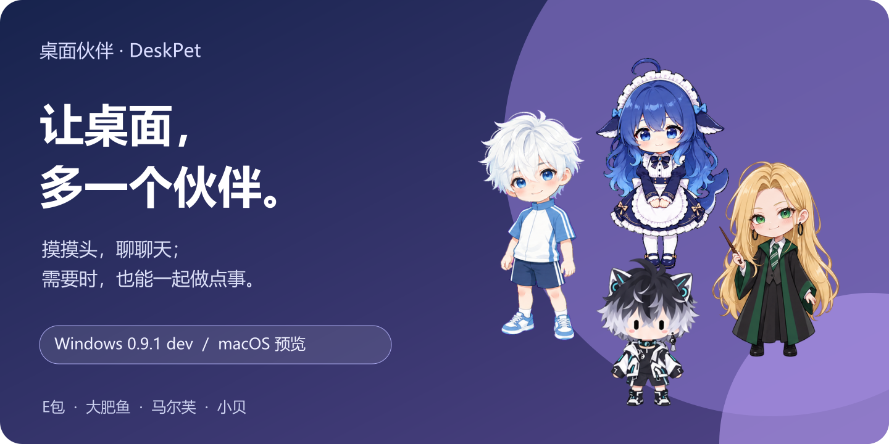
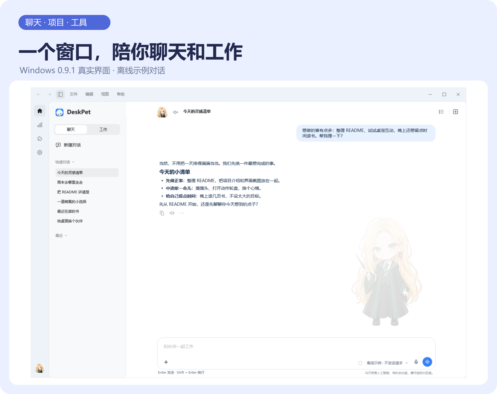

  <picture>
    <source media="(max-width: 640px)" srcset="previews/readme-hero-mobile.svg">
    
  </picture>
  <h1>桌面伙伴 · DeskPet</h1>
  
原画互动 · 独立人格 · 项目工作 · 听写与朗读

  
<a href="#下载安装">下载安装</a> · <a href="#开始使用">开始使用</a> · <a href="docs/configuration-guide.md">配置引导</a> · <a href="CHANGELOG.md">更新日志</a>

DeskPet 是一个住在桌面上的伙伴。你可以让它散步、看向鼠标，摸摸头、投喂；接入自己的模型服务后，还能聊日常、讨论想法，围绕项目一起处理文件。

**当前版本：[0.9.2](https://github.com/Eason4869/deskpet/releases/tag/v0.9.2)**。Windows 将聊天、工具、插件、设置和用量统计放进同一个主窗口；macOS 提供独立预览，界面与能力范围见 [平台与升级](#平台与升级)。本页应用截图以 Windows 为准。

0.9.2 修复侧栏悬浮闪烁、拖动排序和用量矩阵间距；聊天新增默认分区，完整窗口与快速窗口分别保存记录，两种模式均可新建和重命名分区，详见 [更新日志](CHANGELOG.md)。

## 先认识你的伙伴

<picture>
  <source media="(max-width: 640px)" srcset="previews/readme-interaction-mobile.svg">
  
</picture>

四位内置伙伴可以直接切换，也支持导入自制外观。首次启动默认 **E包**；每位伙伴有各自的普通聊天记录、人格和音色偏好。

| 伙伴 | 认识一下 |
| --- | --- |
| **E包** | 白发蓝眸、白蓝运动服，傲娇又毒舌的小伙伴 |
| **大肥鱼** | 蓝白配色的鲸鱼娘，温和又俏皮 |
| **马尔芙** | 金发绿眼的魔法少女，聪明又俏皮 |
| **小贝** | 黑白青色的科技少年，机灵又温柔 |

1. **拖动、单击和抚摸**：换个位置，触发伙伴的互动。锁定位置后保持原位。
2. **鼠标中键**：打开动作轮盘，选择小憩、投喂或招牌动作。轮盘与右键里的跑动会实际移动一小段，到屏幕边缘停止；锁定时原地演示。
3. **双击伙伴**：打开快速对话；**右键伙伴**或**双击托盘图标**可打开完整对话。

伙伴思考或工作时仍能互动。开始拖动、暂停或切换动作，会停止手动跑动。**桌宠互动不需要 AI 配置；文字聊天、听写、朗读与 Live 需要相应模型服务。**

## 一个窗口，陪你聊天和工作

<picture>
  <source media="(max-width: 640px)" srcset="previews/readme-workspace-mobile.svg">
  
</picture>

界面示例来自 Windows 0.9.1，保留完整窗口；会话列表和聊天内容为隔离的本地示例，不含个人记录，未请求模型服务。可点击查看 [主窗口原图](previews/workspace-0.9.1.png)、[动作轮盘](previews/action-palette.png) 和 [快速对话](previews/quick-chat.png)。

### 从一句话，到一个项目

| 场景 | 怎么用 |
| --- | --- |
| **快速对话** | 双击伙伴，在头顶聊两句。重新打开会开始新话题，已有记录保留在当前伙伴的“快速对话”分组。 |
| **聊天** | 使用伙伴的人格，完整窗口聊天保存在“默认分区”或自选聊天分区，分别保留上下文与草稿。 |
| **工作** | 绑定项目目录，读取、搜索和修改文件，查看实际执行记录。需要支持原生工具调用的文字模型。 |

聊天分区直接管理会话，工作分区管理项目及下属会话。两种模式均支持新建、重命名分区；会话点击后保持原位，可拖动排序并保存，也可将工作会话拖入其他项目、普通聊天拖入其他聊天分区。项目和对话支持置顶、归档与分组。切换页面或会话保留草稿与阅读位置；侧栏可用顶栏按钮或 **Ctrl + Shift + S** 收起。

### 写得顺手，看得完整

输入区支持 Markdown 标题、列表、引用、代码和表格；在 **工作设置 → 编辑器** 可切换纯文本模式。默认 **Enter 发送、Shift + Enter 换行**。

通过 **+**、粘贴或拖放添加图片、文件与文件夹引用，Windows 还支持应用窗口快照。上传与返回的图片可在窗口内放大、缩放和拖动查看；按 **Esc** 或点击空白退出。回复支持复制、朗读、重新生成和导出。

听写将语音变成草稿，自动朗读可在对话顶部切换，Live 用于实时语音交流。**预测消息**会额外请求文字模型，可在编辑器设置中关闭；接受建议后仍需确认发送。运行中追加要求可选择 **排队** 或 **引导**，后者在下一处可调整的请求边界接入，不会撤销已经发出的请求或完成的修改。

### 工具就在对话旁边

通过标签栏 **+** 或 **Ctrl + Shift + B** 新建浏览器、文件预览、PowerShell 终端、临时侧边聊天或文件变更页。支持聊天与工具分屏，**Ctrl + Shift + F** 切换完整标签视图，窗口变窄时自动适配。

文件卡片可预览 HTML、Markdown 和带行号的源码，也可系统打开、定位、复制路径或另存为。HTML 外部资源默认关闭；内置浏览器暂不支持下载。临时侧边聊天不读取主聊天上下文与项目文件，关闭后不保存。

主聊天固定在首个标签；隐藏工具区或切换布局保留工具状态，关闭标签才释放实例。手动终端与 Agent 的终端开关、审批独立管理，沿用打开时的项目与沙箱设置，关闭后结束对应进程树。

## 下载安装

Windows 支持 **Windows 10／11 x64、.NET Framework 4.8+**；macOS 预览需要 **macOS 14+**。请按系统和芯片架构选择附件，完整版本说明与校验文件见 [v0.9.2 发布页](https://github.com/Eason4869/deskpet/releases/tag/v0.9.2)。

| 平台 | 下载 |
| --- | --- |
| **Windows 安装版 · 推荐** | [DeskPet-Windows-Setup-0.9.2.exe](https://github.com/Eason4869/deskpet/releases/download/v0.9.2/DeskPet-Windows-Setup-0.9.2.exe) |
| Windows 便携版 | [DeskPet-Windows-0.9.2.zip](https://github.com/Eason4869/deskpet/releases/download/v0.9.2/DeskPet-Windows-0.9.2.zip) |
| Mac Apple Silicon · 预览 | [DMG](https://github.com/Eason4869/deskpet/releases/download/v0.9.2/DeskPet-macOS-0.9.2-arm64-preview.dmg) · [ZIP](https://github.com/Eason4869/deskpet/releases/download/v0.9.2/DeskPet-macOS-0.9.2-arm64-preview.zip) |
| Mac Intel · 预览 | [DMG](https://github.com/Eason4869/deskpet/releases/download/v0.9.2/DeskPet-macOS-0.9.2-x86_64-preview.dmg) · [ZIP](https://github.com/Eason4869/deskpet/releases/download/v0.9.2/DeskPet-macOS-0.9.2-x86_64-preview.zip) |

源码、外观包、创作模板与 SHA256

| 附件 | 下载 |
| --- | --- |
| 完整源码 | [DeskPet-Source-0.9.2.zip](https://github.com/Eason4869/deskpet/releases/download/v0.9.2/DeskPet-Source-0.9.2.zip) |
| 伙伴外观 | [E包](https://github.com/Eason4869/deskpet/releases/download/v0.9.2/Ebao-HD-Skin-0.9.2.zip) · [大肥鱼](https://github.com/Eason4869/deskpet/releases/download/v0.9.2/Dafeiyu-HD-Skin-0.9.2.zip) · [马尔芙](https://github.com/Eason4869/deskpet/releases/download/v0.9.2/Marfu-HD-Skin-0.9.2.zip) · [小贝](https://github.com/Eason4869/deskpet/releases/download/v0.9.2/Xiaobei-HD-Skin-0.9.2.zip) |
| 外观创作模板 | [DeskPet-Skin-Template-v2-0.9.2.zip](https://github.com/Eason4869/deskpet/releases/download/v0.9.2/DeskPet-Skin-Template-v2-0.9.2.zip) |
| 附件校验 | [SHA256.txt](https://github.com/Eason4869/deskpet/releases/download/v0.9.2/SHA256.txt) |

## 开始使用

1. **安装或解压**：运行 Windows 安装程序，或将便携 ZIP 完整解压到可写目录，再运行 `桌面伙伴.exe`。不要在压缩包内直接启动。
2. **选一位伙伴**：先试试拖动、抚摸与动作轮盘；只想使用桌宠，可以跳过 AI 配置。
3. **配置模型**：打开 **设置 → 配置引导**，按需填写文字模型、听写、朗读或 Live 的服务地址、协议、密钥和模型，再主动测试连接。
4. **开始聊天或工作**：双击伙伴快速聊天，或打开完整对话管理上下文、项目和文件。

配置引导支持跳过本步／本章、稍后继续和保留进度；只有主动点击测试才会发送测试请求、播放声音或开启麦克风。首次安装或进入更高主／次版本系列会自动展示一次，同系列补丁不重复，也可在设置中手动重开。

随包提供的文档可离线阅读：[安装、升级与备份](docs/installation.md) · [配置与使用引导](docs/configuration-guide.md) · [模型与语音配置](docs/dialogue-setup.md)。离线查看说明不代表远程模型可离线调用。

## 工作权限，由你掌握

Windows 内置文件 Agent，无需另装 Agent 命令行工具。可查看文件净变更、执行输出、审批与子任务记录；文字模型需支持 OpenAI 或 Anthropic 原生工具调用。

| 会话权限 | 行为 |
| --- | --- |
| **请求批准** | 项目内常规文件操作可直接执行，越界访问、联网等例外交给你确认；Agent 终端命令逐条人工批准。 |
| **帮我批准** | 新配置的默认值，符合条件的操作交给独立审核模型，无法确认或审核失败时转人工；Agent 终端命令仍逐条人工批准。 |
| **完全访问权限** | 经确认后扩大到当前账户可访问的文件范围并关闭工作区沙箱，不会获得管理员权限。 |

Agent 终端默认关闭。启用工作区沙箱时，Windows 通过 **AppContainer** 隔离终端及其子进程，限制目录访问并默认阻止联网；隔离启动失败会停止执行。**开启沙箱不免除“请求批准／帮我批准”下的终端命令确认。** 文件和网页工具由宿主按权限执行，MCP 不在终端沙箱内；MCP 与 GitHub 写入仍独立确认。

计划模式在工具层禁止写入。默认修改前备份，恢复时核对后续改动；只读子任务继承父任务的限制。项目事实由你手动维护，不将模型结论自动当作执行证据。详见 [工作、互动与工具使用](docs/agent-workflows.md) 和 [文件 Agent](docs/conversation-agent.md)。

## 扩展、用量和个人设置

| 入口 | 能做什么 |
| --- | --- |
| **插件 → 技能** | 导入含 `SKILL.md` 的本地文件夹，查看、搜索、启停与移除。导入复制到本机，不修改来源；启用不会自动运行脚本。 |
| **插件 → MCP** | 添加 stdio 或 HTTP 服务器，保存后主动连接，不随应用启动自动运行。HTTP 目前为 JSON 子集，暂不支持 SSE。 |
| **用量统计** | 查看请求次数、Token、全年热力图、7／30 天历史和会话排行，按服务商、模型、项目与功能筛选。 |
| **设置** | 搜索与调整伙伴、模型、工作、通用选项；支持大小、置顶、锁定、鼠标穿透、全屏隐藏、安静模式和快捷键。 |

用量包含新采集的聊天、工作、子任务、审核、预测、标题、压缩和问候等文字请求，暂不含 ASR、TTS 与 Live。实值、估算、未知和真实零分别标记；账本不保存提示词、回复正文或密钥，不等同于服务商账单或套餐余额。

个人设置、密钥、记录与导入内容保存在本机数据目录，迁移或覆盖升级前请备份完整 `data` 文件夹。文件、图片与工具读取结果可能发送给你选择的模型服务，多轮工作按服务商规则计费。自制伙伴见 [外观格式](docs/skin-format.md) 与 [互动扩展](docs/interaction-extension.md)。

## 平台与升级

| 平台 | 当前边界 |
| --- | --- |
| **Windows** | 安装版与便携版，包含本页展示的统一主窗口、桌宠互动、文件 Agent、工具页与 AppContainer 终端隔离。 |
| **macOS 预览** | Apple Silicon／Intel 双架构，共享部分核心，拥有独立界面。Windows 的统一窗口、配置引导与文件 Agent 能力不代表已在 Mac 实现，请以预览发布说明为准。 |

Windows 可在 **关于与更新** 检查正式版本，在空闲时校验并安装。**0.5.4 及更早安装版**需先手动安装 0.5.6，或直接手动安装新版；便携 ZIP 不受安装包改名影响。开发中的改动见 [dev 分支](https://github.com/Eason4869/deskpet/tree/dev)，客户端更新以正式发布附件为准。

Windows 安装包目前未做应用代码签名；Mac 预览为 ad-hoc 签名，未经 Apple Developer ID 公证。安装与备份说明见 [安装指南](docs/installation.md)，素材来源、协议及第三方许可见 [素材与平台说明](docs/sources.md) 和 [第三方声明](docs/third-party-notices.md)。

## 后续计划

- [ ] 应用连接：外部应用的授权、连接状态与可用能力管理。
- [ ] 插件包运行时：包导入、清单与依赖校验、启停及生命周期管理。

---

作者：**彧晟Eason** · [问题反馈](https://github.com/Eason4869/deskpet/issues) · [更新日志](CHANGELOG.md) · [配置文档](docs/configuration-guide.md) · [素材与许可](docs/sources.md)
