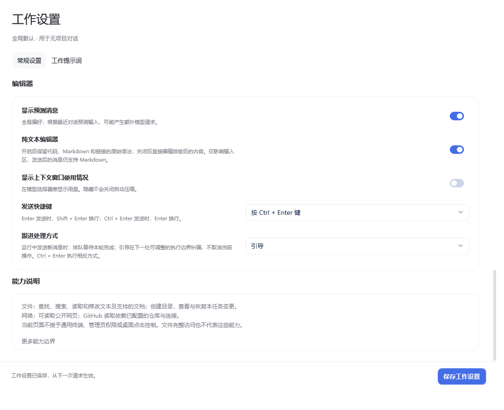

  
  <h1>桌面伙伴 · DeskPet</h1>
  
桌面上有个伙伴，闲聊时认识你，工作时陪你把事情做完。

  
原画互动 · 独立聊天 · 多项目工作 · 听写与朗读

  
<a href="https://github.com/Eason4869/deskpet/releases">下载安装</a> · <a href="#开始使用">开始使用</a> · <a href="docs/configuration-guide.md">完整配置引导</a> · <a href="CHANGELOG.md">更新日志</a>

当前正式版本为 **[0.7.0](https://github.com/Eason4869/deskpet/releases/tag/v0.7.0)**，提供 Windows 安装版、便携版和 macOS 双架构预览。以下新界面与操作说明以 Windows 版为准；macOS 为独立预览客户端，功能差异见下方平台说明。

**dev 开发版本：[0.8.0 源码标签](https://github.com/Eason4869/deskpet/tree/v0.8.0)**，包含 Agent 与互动改进，使用流程见 [工作、互动与工具使用](docs/agent-workflows.md)。此标签不代表正式发布，当前预览保持不变。

## 选一位伙伴

无需接入 AI，伙伴也能看向鼠标、散步、打招呼，接受摸头和投喂，或在忙碌时安静陪着你。

<table>
  <tr><th>E包</th><th>大肥鱼</th><th>马尔芙</th><th>小贝</th></tr>
  <tr>
    <td align="center"></td>
    <td align="center"></td>
    <td align="center"></td>
    <td align="center"></td>
  </tr>
  <tr><td align="center">傲娇毒舌的白发正太</td><td align="center">温和俏皮的鲸鱼娘</td><td align="center">聪明俏皮的魔法少女</td><td align="center">机灵温柔的科技少年</td></tr>
</table>

首次启动默认 E包。每位伙伴拥有自己的聊天记录、人格和音色偏好，也可以导入你制作的外观。

## 随时聊两句，也能认真做点事

### 快速对话：每次打开，开始新的话题

双击伙伴即可打开头顶的快速对话。关闭窗口后再打开，会创建没有上下文的新对话；以前的记录仍在当前伙伴的“快速对话”分区，可以从完整窗口重新查看。

普通聊天跟随伙伴。换一位伙伴，聊天记忆、记录和左侧个人会话列表也跟着切换。普通聊天不能选择项目，会自动保存在“快速对话”分区。

### 完整窗口：聊天与工作各有位置

打开完整对话后，可以在输入框左下角切换 **对话模式** 和 **工作模式**。拉宽或最大化窗口可显示侧栏；增加高度能看到更多记录。更宽的窗口还能显示右侧任务与变更面板。

| 对话模式 | 工作模式 |
| --- | --- |
| 使用当前伙伴的人格与个人记录 | 所有伙伴共享工作项目、记录与工作提示词 |
| 不选择项目，保存在“快速对话” | 草稿上方显示“选择项目”，也可不绑定项目 |
| 适合闲聊、问答和整理想法 | 适合阅读项目、分析文件和执行已接入的文件操作 |

侧栏可新建分区、项目和对话，展开或收起项目，搜索或切换记录。对话行悬浮时显示置顶与归档图标；永久删除使用应用内确认窗口。“快速对话”和“最近”是固定分组，可以展开收起，不可重命名或移除。

### 输入、排版和链接

输入区默认直接编辑排版后的内容，隐藏 Markdown 标记。偏好原始语法时，在 **工作设置 → 编辑器 → 纯文本编辑器** 开启开关；切换保留草稿，发送后的消息仍支持 Markdown。

- 支持标题、列表、加粗、引用、代码和表格等常用排版。
- 用户消息气泡随内容收缩，长内容达到上限后换行。
- 输入区、用户消息和助手回复统一使用图标与可点击链接；GitHub 使用专用 Logo，其他网站使用地球图标，不显示域名胶囊。
- **+**、粘贴和拖放可添加图片、文件或文件夹引用。Windows 还支持添加应用窗口快照。
- 默认 Enter 发送、Shift + Enter 换行，也可改为 Ctrl + Enter 发送。
- 回复末尾可复制、朗读、重新生成或导出；执行过程可展开查看。

**显示预测消息**默认开启：根据最近对话预测下一条输入，先填入草稿，不自动发送。预测会额外请求文字模型，可在编辑器设置中关闭。

### 运行中也能调整方向

发送跟进消息时，可选 **排队** 或 **引导**。排队等本轮完成后再处理；引导让当前操作继续，在下一处可调整的模型或工具边界接入新要求，重新安排尚未执行的步骤。同一个任务会继续，活动状态显示在最新引导消息下方。

已经发出的模型请求不能中途追加输入，已经完成的文件修改也不会自动撤销。运行中按 Ctrl + Enter 使用相反的跟进方式；需要主动停止后重发时，选择“停止并立即发送”。

## 工作设置：按项目做事，清楚知道权限

Windows 内置文件 Agent，无需额外安装命令行工具。它可以查找、搜索、读取和修改文件，创建目录，并查看任务产生的文件变更。模型需支持 OpenAI 或 Anthropic 原生工具调用。

- **文件访问范围**：完整访问沿用当前 Windows 账户权限；也可限制在工作目录，不会申请管理员权限。
- **计划模式**：只读取和分析，在工具层禁止写入和打开目录等操作。
- **修改前备份**：默认开启；恢复前核对文件后续改动，避免覆盖外部修改。
- **上下文**：跟随模型配置中的容量自动管理；仅在容量未知时使用兜底值。用量圆环可隐藏，不影响自动压缩。
- **工作提示词**：在单独标签页配置，所有工作对话共用；普通聊天仍使用各自伙伴人格。

当前桌面端没有通用终端、管理员提权、桌面点击控制或项目命令配置入口；MCP 连接、自动子 Agent 执行和 GitHub 写入也尚未提供完整的用户入口。模型声称“已运行”不能代替工具执行证据。详见 [对话与工作说明](docs/conversation-agent.md)。

文件内容、图片及工具读取结果可能发送给所选模型服务商；多轮工作会产生多次请求，按服务商规则计费。

## 开始使用

1. 从 [Releases](https://github.com/Eason4869/deskpet/releases) 选择实际提供的 Windows 安装版或便携 ZIP。便携版完整解压后运行 `桌面伙伴.exe`，不要在压缩包里直接启动。
2. 先选择伙伴，试试拖动、单击、双击与中键轮盘。只使用桌宠可以跳过 AI 配置。
3. 从设置左下角打开 **配置引导**，按自己的需要配置聊天、听写、朗读和 Live。

Windows 支持 Windows 10/11 x64，需要 .NET Framework 4.8，无需 Node.js 或 Docker。安装版无需管理员权限。

### 选择下载文件

下表按推荐下载顺序排列；GitHub 附件区可能自行排序，请按平台与 CPU 选择。macOS 的 `preview` 表示预览客户端，不代表已同步本版 Windows 的所有功能。

| 顺序 | 用途 | 文件 |
| --- | --- | --- |
| 1 | Windows 安装版（推荐） | [DeskPet-Windows-Setup-0.7.0.exe](https://github.com/Eason4869/deskpet/releases/download/v0.7.0/DeskPet-Windows-Setup-0.7.0.exe) |
| 2 | Windows 便携版 | [DeskPet-Windows-0.7.0.zip](https://github.com/Eason4869/deskpet/releases/download/v0.7.0/DeskPet-Windows-0.7.0.zip) |
| 3 | Mac Apple Silicon 预览 | [DMG](https://github.com/Eason4869/deskpet/releases/download/v0.7.0/DeskPet-macOS-0.7.0-arm64-preview.dmg) · [ZIP](https://github.com/Eason4869/deskpet/releases/download/v0.7.0/DeskPet-macOS-0.7.0-arm64-preview.zip) |
| 4 | Mac Intel 预览 | [DMG](https://github.com/Eason4869/deskpet/releases/download/v0.7.0/DeskPet-macOS-0.7.0-x86_64-preview.dmg) · [ZIP](https://github.com/Eason4869/deskpet/releases/download/v0.7.0/DeskPet-macOS-0.7.0-x86_64-preview.zip) |
| 5 | 完整源码 | [DeskPet-Source-0.7.0.zip](https://github.com/Eason4869/deskpet/releases/download/v0.7.0/DeskPet-Source-0.7.0.zip) |
| 6 | 伙伴外观 | [E包](https://github.com/Eason4869/deskpet/releases/download/v0.7.0/Ebao-HD-Skin-0.7.0.zip) · [大肥鱼](https://github.com/Eason4869/deskpet/releases/download/v0.7.0/Dafeiyu-HD-Skin-0.7.0.zip) · [马尔芙](https://github.com/Eason4869/deskpet/releases/download/v0.7.0/Marfu-HD-Skin-0.7.0.zip) · [小贝](https://github.com/Eason4869/deskpet/releases/download/v0.7.0/Xiaobei-HD-Skin-0.7.0.zip) |
| 7 | 外观创作模板 | [DeskPet-Skin-Template-v2-0.7.0.zip](https://github.com/Eason4869/deskpet/releases/download/v0.7.0/DeskPet-Skin-Template-v2-0.7.0.zip) |
| 8 | 校验文件 | [SHA256.txt](https://github.com/Eason4869/deskpet/releases/download/v0.7.0/SHA256.txt) |

Mac 需要 macOS 14+，应用自包含，无需另装 .NET。预览仅 ad-hoc 签名，未经 Apple Developer ID 签名或公证。Windows 安装包目前也未做应用代码签名；下载后可用 SHA256 核对文件。包名和更新兼容说明见 [发布包命名规范](docs/release-naming.md)。

### 细分到每一步的配置引导

Windows 引导包含 **17 章、118 个小步骤**：从伙伴与人格、实际互动，到文字模型、听写、云端 TTS、音色、朗读测试、Live，再到窗口大小、分区、项目、对话、工作设置与编辑器。

可返回上一步、跳过本步或本章、稍后继续，也可从目录直接进入需要的章节。关闭后保留具体步骤。保存设置、阅读说明与真实服务测试分别记录；只有明确点击测试，才会发送测试请求、播放声音或开启麦克风。

第一次安装或升级到更高主／次版本系列会自动打开一次引导；同系列补丁不重复。随时可从设置手动重开。完整步骤见 [离线配置引导](docs/configuration-guide.md)。

### 添加文字模型

1. 在 **设置 → 模型配置 → 文字模型** 新增服务商，选择厂商或自定义接口。
2. 确认服务地址、协议和代理，填写自己的 API Key，保存并获取候选模型。
3. 在候选列表中逐个点击 **+** 添加模型；获取失败也可以手动填写模型 ID。按服务商实际能力填写上下文容量，可设置中文显示名称。
4. 选择要使用的模型并保存。之后可从聊天输入区切换，正在运行的请求保留原模型，后续请求使用新选择。

文字、语音识别、云端朗读和 Live 分别管理服务商、密钥与代理；同名厂商不代表共享配置。使用 OpenAI Chat Completions 或 Anthropic 兼容协议的实际能力，以服务商与账号权限为准。

### 听写、朗读与 Live

| 功能 | 配置与使用 |
| --- | --- |
| 麦克风听写 | 配置语音识别服务后，点击输入框麦克风；停止可识别为草稿，发送可识别后提交，Esc 取消 |
| 回复朗读 | 选择 Windows 系统语音，或明确开启云端 TTS 并配置服务、模型、音色；先测试朗读，再开启回复朗读 |
| Live 实时通话 | 独立配置 Gemini Live 与音色，连接成功后开启麦克风；挂断或关闭通话可停止收音 |

音量默认 50%，可即时调节并保存。音色按伙伴与服务模型保存，支持下拉选择及手填 Voice ID。聊天、听写、朗读与 Live 的配置和测试相互独立，配置文字模型不会自动开启云朗读。

详见 [模型与语音配置](docs/dialogue-setup.md) · [音色预设](docs/voice-presets.md)。

## 日常陪伴与外观

| 操作 | 用途 |
| --- | --- |
| 拖动后松开 | 拎起、落地，可能短暂踉跄 |
| 单击头部／身体 | 摸摸头／戳一戳 |
| 双击伙伴 | 快速对话 |
| 鼠标中键 | 打开动作轮盘，选择投喂、小憩或招牌动作 |
| 右键伙伴 | 互动、切换外观、打开完整对话与设置 |
| 托盘图标 | 显示或隐藏、暂停、关闭鼠标穿透、退出 |

免打扰可暂停问候、散步和自动朗读；可设置全屏时隐藏、锁定位置、鼠标穿透和登录自启。主动问候默认使用角色预设，不消耗模型额度；改用 AI 生成时会请求文字模型。快捷键可修改或留空停用，冲突时会提示。

外观支持 v1 透明图集与 v2 分动作 PNG；在 `pet.json` 中填写名字、人格、帧数、播放速率和招牌动作，再从设置导入。见 [外观格式](docs/skin-format.md) · [创作模板](templates/README.md)。

## 数据、升级与平台

配置、导入外观及历史保存在程序目录的 `data`。Windows 密钥与保存的会话内容使用当前账户加密；导出的 Markdown 是普通可读文件，分享前请自行检查。升级前可以备份整个 `data` 目录。

Windows 可在“关于与更新”检查已发布版本，校验下载后在空闲时安装；推送到 dev 的代码不会自动成为更新包。0.5.4 及更早安装版需先手动安装 0.5.6，或直接手动安装新版；便携 ZIP 不受安装包改名影响。详见 [安装、升级与备份](docs/installation.md)。

macOS 14+ 提供 Apple Silicon / Intel 预览，复用共享核心，但界面与 Windows 不完全同步：本页的新版侧栏、直接编辑 Markdown、118 步引导和 Windows 文件 Agent 不代表已在 Mac 实现。Mac 仍以普通聊天、Markdown 显示、附件与语音功能为主，不提供本地文件 Agent 或应用窗口快照。预览未经 Apple Developer ID 签名或公证，附件及限制以发布说明为准。

---

作者：**彧晟Eason** · [反馈问题](https://github.com/Eason4869/deskpet/issues) · [素材与协议来源](docs/sources.md)
