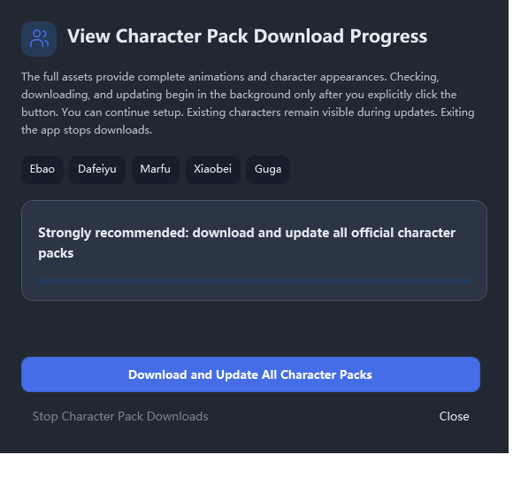

# 0.11.2-dev.2 首批性能优化与下载弹窗结果

第二批已继续实施，见 [第二批结果](2026-10-27-stage2-results.md)。本文件保留首批历史指标与构建 hash；同一预览路径现已更新，请以第二批结果中的当前 hash 为准。

日期：2026-10-27。基线：`c68b4aa`，用户确认的本地最新开发代码，版本 `0.11.2-dev.2`。分支：`codex/performance-0.11.2-dev.2`。没有更改原开发工作树、版本号、标签或发布。

## 已交付改动

- WPF 设置仅先构造默认伙伴页，AI、Work、Quiet、About、IM 首次访问才创建，之后复用；未访问页不参与脏状态/后台刷新/释放。
- 导航、搜索锚点、Guide、前进后退与显式保存入口先确保目标页存在。已访问 Provider、Work、IM 草稿保留。
- Work/Quiet 隐藏时不再随普通 RefreshState 更新；激活补刷最新已提交设置，继续保护未保存输入。
- AI 子页每次切换不再拆旧 ScrollViewer、分配新容器；复用原有滚动容器与内容。AI 编辑器的真正二级懒创建尚在下一阶段。
- Avalonia 设置改为页面工厂与已创建结果缓存；恢复默认不构造未访问 Behavior/Storage；关闭只释放实际创建的编辑器。
- 全量下载弹窗按两端主题整理为说明、角色范围、当前角色/进度、固定操作区；失败/取消显示重试，完成显示满进度。关闭视图不取消后台下载，停止按钮才取消。
- WPF 设置 CanMinimize，原生 WS_MAXIMIZEBOX 不存在；Avalonia CanMaximize=false、CanResize=false。下载通知合并为一个待处理 UI 调度，避免进度事件堆积。
- 删除 PetOfficialCompanions 内临时拼装窗口的重复视图逻辑，集中到独立 CompanionPreparationWindow；未删除仍在使用的旧皮肤/兼容业务链。

## 性能样本

同一 Windows 沙箱会话，Build.ps1 的 `/optimize+` 编译。隔离数据、无凭据、不启用自动更新/热键、未启动真实频道。每次 10 个新 SettingsPage 实例，在同一进程内复用 PetWindow；末次实例做 30 次伙伴/AI 往返。使用同一 `SettingsPerformanceTests --measure`，没有强制 GC。改后采样前已结束其他构建/UI 测试。

| 指标 | 基线 | 改后 | 解释 |
|---|---:|---:|---|
| 构造中位数 | 173.017ms | 22.623ms | 降低约 86.9% |
| 构造 P95/最大值（10 样本） | 2126.404ms | 1166.348ms | 10 样本 P95 等于最大样本，受首次 JIT/缓存影响，不外推稳定尾延迟 |
| 首次布局/render callback 中位数 | 400.622ms | 239.093ms | 降低约 40.3%，不是 OS 呈现或输入可用延迟 |
| 首次布局/render callback P95/最大值 | 4336.692ms | 4007.104ms | 首次初始化仍有明显开销 |
| 30 次切换中位数，含首次 AI | 13.598ms | 14.730ms | 本样本略高，不宣称所有切换都变快 |
| 30 次切换 P95，含首次 AI | 42.034ms | 35.841ms | 本样本降低约 14.7% |
| 30 次切换最大值 | 63.700ms | 542.036ms | 延迟创建将 AI 初次构建移到首次访问，须继续优化，不能隐藏此取舍 |
| 末尾进程 Private Bytes | 368496640 | 359763968 | 单点快照，不是稳定保留堆或泄漏证据 |
| 末尾进程 Working Set | 508854272 | 486576128 | 同上；不作为确定内存节省比例 |

初次 AI 页的 542ms 峰值把后续路线 B 提升为下一阶段最高优先级：先分段测 TextProviderEditor、语音编辑器、ImageGenerationSettings 及初次布局，再拆真正的二级初始化。不能为了让设置打开快，把这项成本当成已经消失；本批只声称默认设置打开路径改善。

完整应用新进程/冷启动、真实业务数据/压力数据、CPU/GC、稳定内存和长时间往返均未在本批完成；原计划中相应工作继续保留。

原始日志（工作树忽略目录）为 `work/performance/baseline-settings.log`、`optimized-settings.log`。新工具的统计采用排序后上中位数，基线与改后口径相同。

## 测试与构建

| 项目 | 结果 |
|---|---|
| SettingsPerformanceTests 生命周期 | 21 通过；先验证旧实现未访问页提前构造的 RED，再 GREEN |
| AI 滚动容器复用 | 旧实现专门 RED，修改后 GREEN |
| EmbeddedSettingsTests | 13 通过 |
| SettingsNavigationSmoke | 66 通过 |
| SettingsFeatureNavigationTests | en_US 44、zh_CN 44 通过 |
| ImChannelUiTests | 通过，包含切页/语言与窄布局 |
| WorkSettingsTests | 67 通过 |
| LiveLanguageUiTests | 61 通过 |
| OnboardingSmoke | 原生鼠标模式被沙箱拒绝 SetCursorPos（Win32 5）；原有 `--simulated` 模式 85 通过，未验证真实手势 |
| OnboardingModelSmoke | 沙箱内本机 HTTP 连接失败；获批在沙箱外运行同一离线 fixture，56 通过 |
| Avalonia SettingsLazyChecks | 12 通过；旧实现全部页提前构造的 RED 已确认 |
| Avalonia 中英文导航 | zh_CN 24、en_US 24 通过 |
| Avalonia IM UI | 7 通过 |
| WPF 下载弹窗 | 14 通过，包含原生禁止最大化、打开不启动/关闭不取消、状态/停止/重试/完成、多语言/主题截图 |
| Avalonia 下载弹窗 | 8 通过；旧 CanMaximize 为 true 的 RED 已确认，最终高度调整后重建并复验 |
| Avalonia Release 完整 fixture 构建 | 0 错误；114 项既有/分析器/NU1900 警告，未刷新在线 NuGet 漏洞数据 |
| WPF 运行预览构建 | 通过；最终检查发现并修复本轮编辑脚本时丢失 UTF-8 BOM 的问题，重新构建后中文程序名、config 与版本信息正确 |
| git diff --check | 通过 |
| 独立只读代码审查 | `c68b4aa..0007206` 未发现实质性 correctness/security/architecture/performance 缺陷 |

没有实测 macOS/Linux 原生系统标题栏、图形后端或真实网络角色下载；Avalonia headless 不替代那些验证。

可运行 WPF 预览：`work/performance/preview/桌面伙伴.exe`，269897216 bytes，文件版本 `0.11.2.0`。这是本分支的本地构建，版本声明仍为 `0.11.2-dev.2`，没有打包或发布新版本。

SHA256：`72DFE0A44E5BBA77756BA5AEF016EFE6655B23B53F31FBB006C5F5FCD2667171`。

## 界面预览

截图为离线受控 40% 进度，不代表真实包已下载。WPF 截图为客户区；是否禁用系统最大化由原生 style 测试独立验证。

## 实现取舍与剩余工作

- 首批收敛到可独立审查的设置路径与用户追加弹窗，保存协调、启动壳、动画、历史仍在路线图；代价是需要后续迭代，特别是首次 AI 峰值。
- 六个固定设置类别采用具体 EnsureCategory 工厂而非通用 slot 框架；代价是后续新增类别需要显式接线，由路由回归保护。
- Git Bash 记账脚本被沙箱命名对象权限拒绝，采用同目录格式的 PowerShell ledger；代价是任务跟踪由本次实现者维护。
- 鼠标测试以既有模拟模式补测逻辑；代价是真实系统手势未验证，不能宣称全链路设备验收完成。

审查没有遗留 minor findings。每个实现阶段已独立提交；没有数据格式迁移，可按提交回退。工作树与进度记录保留用于下一阶段，不自动合并、推送或公开发布。
