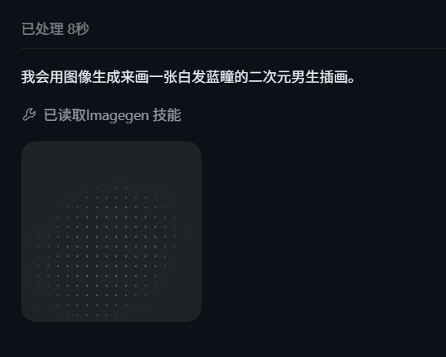
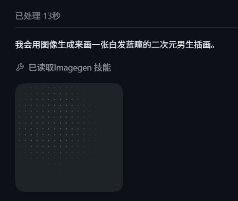
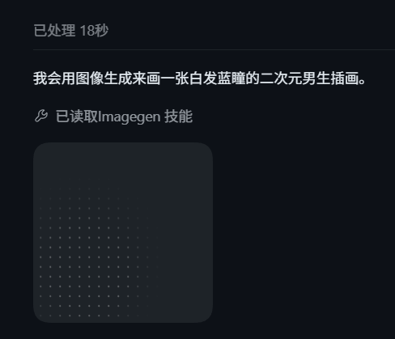

# 0.10.2-dev.3 图像工作流程设计

**状态：** 待评审的设计草案；本轮只新增计划与参考图，不修改产品代码或版本。

**已核对基线：** 远端 `origin/dev` 为 `71d853b3a5e701a3f876bda95a9cc12b39b5c203`，与远端 `v0.10.2-dev.2` 的提交相同。该标签已存在，不重打、不覆盖，不发布 GitHub Release。实施开始前再次 fetch；如 dev 前进，合入并重新核对，不将旧快照当作最新代码。

**目标：** 为页面与对话生图增加一致的点阵动效，提供统一生图任务中心和可整理的图库，并支持同一条回复中的多图切换。

## 1. 范围与方案

本版包含：

- 生成页、配置页测试生成、对话 `generate_image` 共用任务调度、状态及取消。
- 参考图中的圆角点阵占位动效；成功后在原位置显示图片。
- 对话多图采用左侧主图、右侧可点击缩略图；窄窗口缩略图在下方。
- 图库收藏、筛选、排序、多选、批量原图导出、回收站、恢复及受引用保护的永久删除。
- 任务列表、排队、并发限制、取消、显式重试、历史记录及重启状态恢复。
- WPF 与 Avalonia 同步，沿用现有导航、主题、字体、按钮、表单、卡片和弹层。

不扩展本次需求至供应商批量 API、多图编辑、新增生图协议、后台构建工具、浏览器自动化或新的模型管理系统。多图布局支持一条回复的多个独立生成结果，不自动增加请求张数。

方案比较：仅给三个入口分别加动画改动较少，但任务中心无法可靠管理其生命周期；引入通用后台任务平台会扩大本版范围。采用**专用、共享的生图任务管理器**，继续复用现有 `ImageGenerationClient` 与资产存储。

## 2. 当前代码与需要补齐的地方

| 现有实现 | 本版调整 |
| --- | --- |
| 页面与配置页各自持有 CTS，直接调用客户端 | 请求统一提交管理器；界面只订阅快照，脱离界面也能管理任务 |
| 对话生成完成后才附加 `GeneratedImages` | 提交时写入轻量任务 ID，先显示占位卡；完成后关联原资产 |
| 客户端负责网络、URL 下载与资产提交 | 保留流程，增加生成 / 下载 / 保存阶段回调，不编造百分比 |
| `GeneratedImageStore.List()` 返回生成结果 | 增加可兼容旧索引的收藏、回收站和来源字段，以及后台查询 |
| 每个生成结果渲染一个完整卡片 | 同一助手消息合并成一个多图组件，按稳定顺序切换 |
| 图片、索引已有原子保存与临时数据策略 | 延续；增加任务记录、引用保护及永久删除事务 |

Windows 继续兼容 C# 5 / .NET Framework；共享逻辑通过 `desktop/DeskPet.Core/DeskPet.Core.csproj` 显式引入，Avalonia 使用现有 .NET 10 项目，不增加动画、数据库或队列库。

## 3. 动效与多图交互

### 3.1 参考素材

下图由用户提供，仅作为视觉参考；截图中的“已读取 Imagen 技能”等文字不是产品需求，也不改变现有工具执行逻辑。

| 点阵效果 8 秒 | 13 秒 | 18 秒 |
| --- | --- | --- |
|  |  |  |


### 3.2 点阵占位卡

- 默认约 224 × 224 DIP、18 DIP 圆角，受容器宽度约束；背景与点色使用当前主题的中性色，不硬编码参考图的深色背景。
- 点阵坐标固定，点间距约 12 DIP、直径约 1.5 DIP；柔和光斑沿闭合路径缓慢移动，改变局部点亮度。建议周期 5 秒，透明度约 0.04–0.40，最终微调以浅深主题实图为准。
- 生成、下载、保存阶段显示同一动效，并显示真实阶段和运行耗时；排队显示队列位置与静态点阵。等待时间与实际运行时间分别计算。
- 成功后停止动画，在原位置约 180 ms 淡入可预览图片；按原图比例适配，不裁剪原图。文件已保存但平台不能解码时停止动效并展示下载入口。
- 取消、失败、重启中断均停止动效，显示明确状态及适用操作。错误文案不含密钥或原始服务响应。
- 可见控件动画最高 30 FPS；使用原生绘制，不为每个点创建控件，不通过每帧重建消息列表实现动画。
- 页面隐藏、控件卸载或窗口最小化时停止重绘；恢复显示后根据同一任务时间继续呈现，不重发请求。
- 复用 WPF 现有系统减少动画判断；新增“生图动效”偏好，默认开启。关闭动效或系统减少动画时保留静态点阵、阶段、耗时和取消操作。Avalonia 同步提供此偏好，系统检测能力按实际平台实现。

### 3.3 同一条回复中的多图

- 单图使用主图；两张及以上显示主图与缩略图列表。宽布局右侧缩略图约 64 DIP、间距 8 DIP，选中项采用现有主题强调色描边。
- 容器宽度不足 480 DIP 时，缩略图改为底部横向滚动；大图点击仍进入已有缩放、拖动和详情预览。
- 每个请求先创建稳定槽位，按提交顺序排列；返回乱序不会重排缩略图。排队 / 生成 / 失败可与成功图片同时存在。
- 用户尚未选图时，首张完成结果可自动成为主图；用户手动选择后，新结果不抢占。切换仅更新主图、详情及操作目标。
- 预览、复制、另存、详情均针对当前选中图片；批量操作通过图库多选执行。
- 分组按原会话与原消息 ID，不能把不同回复、不同会话或引导后新回复的结果混在一起。历史恢复保留已有图片和槽位顺序；不把 Base64 加入消息。

## 4. 生图任务中心

### 4.1 入口与默认规则

保留左侧“图像”入口，页内扩展为 **生成 / 图库 / 任务** 三个标签；任务标签显示未完成数量。界面和对话均可跳转对应任务，无新左侧图标。

- 应用级一个 `ImageGenerationTaskManager`。默认全局并发 **1**，可设 **1–4**；同一服务最多 1 个运行请求。队列按先提交且可执行者调度，不让忙碌服务阻塞其他服务的可用槽位。
- 排队上限 **50**，超过时在发请求前提示。每项仍只生成单图，调用现有六协议适配，不发送统一 `n>1`。
- 同一 UI 提交 ID、同一会话 / Agent 任务 / 工具调用 ID 重复到达时复用已有任务；相同提示词的明确新提交允许生成新任务。
- 提交后冻结服务、模型、参数及参考图快照。密钥只存在既有设置和内存运行快照中；任务持久记录不序列化 `ConnectionSettings`、明文或加密密钥、Base64。
- 修改配置不改变已提交请求；删除服务时显示关联未完成任务，提供“取消任务并删除”及取消删除操作。
- 页面、设置页、聊天窗口关闭只释放视图订阅，任务继续由应用持有。停止 Agent 任务、删除其会话或用户显式取消时取消对应未完成生成；归档运行中的会话沿用现有操作限制，不转移结果归属。

### 4.2 状态、取消与重试

```text
Queued → Generating → Downloading（URL 响应时）→ Saving → Succeeded
             └ Base64 响应可直接进入 Saving
未提交 / 运行阶段可取消 → Canceled
请求 / 下载 / 保存失败 → Failed
退出或异常重启后尚未完成的任务 → Interrupted
```

- 任务记录创建成功后才允许 HTTP；图片与资产索引提交成功后才允许 `Succeeded`。已提交的资产优先于稍后到达的取消，不丢弃已保存结果。
- 网络任务超时从开始执行时计时，不把排队时间算入服务超时。取消排队项不发送 HTTP；运行中取消中止本地请求，服务端是否继续由服务决定。
- 单个生图任务被取消时，Agent 工具收到可读取消结果；不将其误当作整个 Agent 的停止。Agent 自身停止的 token 仍终止其调用。
- 不自动重试。用户点击“重新生成”创建新任务 ID，保留来源任务 ID；界面明确这将发起新请求。重启后也不自动补发。
- 生成与“写回对话”分开记录：资产已保存而历史写入失败时，图片保留，任务显示“图片已生成，对话同步失败”。操作为“重试同步 / 打开图库”，不能再次请求生图。
- 已结束的 Agent 调用不因任务中心重试而被改写；这类新结果保留在图库和任务中心，用户在聊天中再次要求生成则建立新轮次。

### 4.3 持久化与恢复

- 任务使用独立、加密、原子写入的 `generated-images/tasks.dat`，最多保留 2,000 条终态记录及未完成项，总文件上限 64 MB；仅在状态转换时写入，不每秒保存耗时。
- 每个任务关联稳定 `ImageJobId`，生成资产也保存此 ID。异常重启后先核对已提交资产，能找到结果则恢复成功记录，防止“结果落盘但任务状态未落盘”导致重复付费请求。
- 其余未完成项变为 `Interrupted`，等待用户检查并重新提交；持久记录不含凭据，重试从当前配置重新确认服务与模型。
- 私有参考图在提交阶段独立保存并持有使用租约，排队时不依赖原始上传路径或长驻大块 Base64。
- 关闭历史保存时，新增任务及资产遵循现有临时策略，正常退出清理；开关改变时与现有资产提升逻辑协调，不能留下持久任务引用已清理资产。
- 应用真正退出时停止接单，取消未完成项并给最多 5 秒释放及落盘窗口；下次启动按中断恢复，不恢复网络副作用。

## 5. 图库管理

### 5.1 浏览与批量操作

- 保留瀑布流 / 等大网格、缩略图和点击详情；顶栏增加全部 / 收藏 / 回收站，以及关键词、服务 / 模型、来源、时间范围筛选，默认新到旧，可切换旧到新。
- 来源区分页面生成、对话生成、配置测试与旧记录未知来源；旧数据通过已有元数据兼容识别，不据模型名猜来源。
- 默认 40 张分页或增量加载，解码与筛选在后台执行；不一次读取所有原图。选择按资产 ID 维护，切换筛选时明确清空选择，“全选”表示当前已加载项。
- 鼠标悬停或键盘聚焦显示收藏 / 选择入口；进入多选后显示已选数量和批量导出 / 收藏 / 移入回收站工具栏，不为每张图增加常驻文字行。
- 批量导出原始字节到用户选择目录，一次读取一张，显示完成 / 跳过 / 失败数量；文件名使用时间与资产 ID，冲突不覆盖，取消保留已导出文件并清理本次临时文件。

### 5.2 回收站与引用保护

- 新增 `IsFavorite`、`TrashedUtc` 兼容字段；移入回收站只改变索引可见性，不改变原图路径与 ID，因此原聊天仍能预览和另存。恢复清除回收站标记。
- 回收站提供恢复、永久删除、清空；不自动按天清理。永久删除前使用现有确认弹层，展示数量及预计释放空间。
- 永久删除只作用于回收站中、确认无引用的资产。活动 / 归档 / 未打开会话的历史、内存中的未保存消息、正在排队或执行的参考图，以及其他结果的 `ReferenceImageId` 都纳入保护。
- 后台引用扫描未完成、历史损坏或无法解密时不猜测“未引用”；阻止相关永久删除并说明原因。批量清空跳过受保护项，返回逐项结果。
- 新增引用与删除使用同一资产租约协调器，避免扫描后新增引用的竞态。引用创建前取得租约，持久保存确认后才释放；永久删除取得排他资格后再次扫描。扫描不在 UI 线程运行。
- 删除采用可恢复事务：写清理日志 → 将候选原图移入私有隔离目录 → 提交新索引 → 清理隔离文件。失败或崩溃按索引提交情况回滚或继续清理，图库“恢复索引”不得复活已确认删除的图片。
- 已完成任务中的结果链接是弱链接，永久删除后显示“图片已删除”；排队 / 执行中的参考图是强引用。共享参考图只在最后一个结果和活动任务都不再使用时随显式清理释放。
- 用户另存文件不属于资产清理范围。

## 6. 实施顺序与验收

1. 共享任务状态、持久化、队列及客户端阶段事件。
2. 接通页面 / 配置测试 / 对话，稳定任务与原消息归属。
3. 点阵占位动效和对话多图组件。
4. 图库元数据、引用保护、回收站及清理事务；随后接入图库 UI 和批量导出。
5. 完成任务中心 UI、偏好与跨入口同步。
6. 回归、真实服务、主题 / 窄窗口 / 减少动效验收，再将版本改为 `0.10.2-dev.3`。

关键场景：三个入口同时排队；多图乱序完成、部分失败和选中后继续生成；取消与落盘竞态；切换会话和关闭视图；重启不重复请求；历史关闭；引用中图片与共享参考图保护；永久删除中断；后台隐藏后无动画计时器残留。

自动化与真实服务结果分别记录。真实服务仅做明确的小规模生成，不将模拟测试写成真实供应商验证；macOS 原生行为须在真机或 CI 验证，Windows 上的 Avalonia 测试不替代它。

实施任务、文件及接口见 [实施计划](2026-10-22-image-workflow-dev3-plan.md)。
